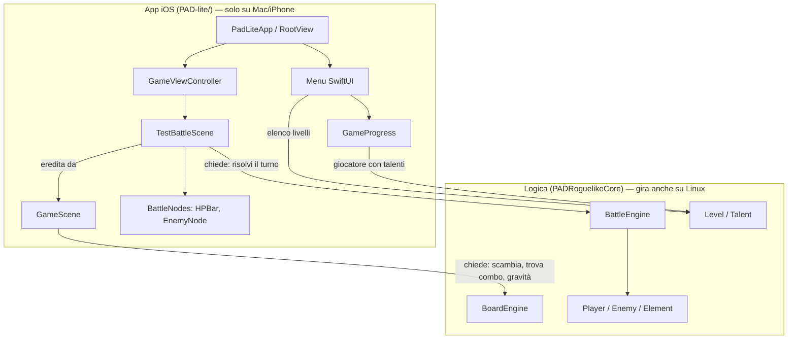
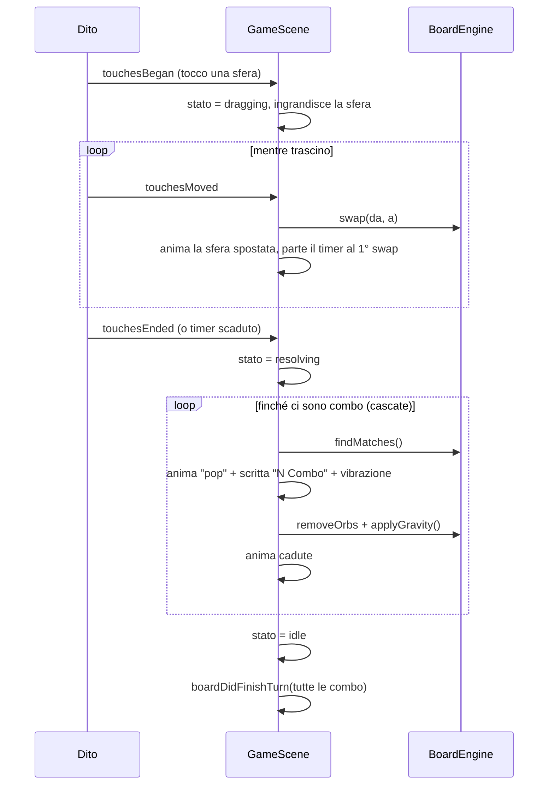
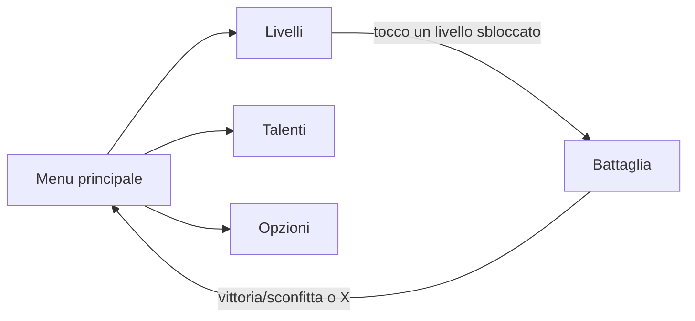

# Guida al codice (per chi non conosce Swift)

Questo progetto è un piccolo gioco iOS in stile **Puzzle & Dragons**: trascini una sfera ("orb") sulla griglia, la scambi con le vicine, e quando allinei 3+ sfere dello stesso colore fai una **combo**. Le combo infliggono danni ai nemici; se non li sconfiggi, loro ti attaccano.

---

## 1. Mappa del progetto

```
hello-world-ios/
├── project.yml                     ← ricetta per generare il progetto Xcode (tool "XcodeGen")
├── builder.json                    ← impostazioni della CI (nome progetto, scheme, bundle ID)
├── .github/workflows/              ← CI su GitHub: compila l'app su un Mac remoto
├── PAD-lite/                       ← L'APP iOS (grafica, tocchi, animazioni, menu)
│   ├── PadLiteApp.swift            ← punto di ingresso: mostra il menu o la battaglia
│   ├── ContentView.swift           ← schermata di prova vecchia, NON usata dal gioco
│   ├── Assets.xcassets/            ← immagini dell'app (per ora solo l'icona)
│   │   └── AppIcon.appiconset/     ← metti qui AppIcon.png (1024×1024)
│   ├── Menu/                       ← schermate del menu (SwiftUI)
│   │   ├── GameProgress.swift      ← salva livelli completati, talenti, opzioni
│   │   ├── MainMenuView.swift      ← menu principale: Gioca / Talenti / Opzioni
│   │   ├── LevelSelectView.swift   ← lista dei livelli (bloccati/sbloccati/completati)
│   │   ├── TalentsView.swift       ← spendi i punti talento
│   │   └── OptionsView.swift       ← tempo per mossa, vibrazione
│   └── Game/
│       ├── GameViewController.swift ← crea la "tela" di gioco e calcola dove disegnare la griglia
│       ├── GameScene.swift          ← disegna la griglia, gestisce il trascinamento e le combo
│       └── Battle/
│           ├── TestBattleScene.swift ← aggiunge nemici, barra HP, turni, vittoria/sconfitta
│           └── BattleNodes.swift     ← "pezzi grafici": barra HP, nemico, testo fluttuante
└── Packages/PADRoguelikeCore/      ← LA LOGICA PURA (regole, niente grafica)
    ├── Package.swift               ← configurazione della libreria
    ├── Sources/PADRoguelikeCore/
    │   ├── OrbModel.swift          ← tipi base: sfera, posizione, combo
    │   ├── BoardEngine.swift       ← regole della griglia: genera, scambia, trova combo, gravità
    │   └── Combat/
    │       ├── Element.swift       ← elementi e vantaggi (fuoco batte legno, ecc.)
    │       ├── Player.swift        ← il giocatore (HP, attacco, cura)
    │       ├── Enemy.swift         ← i nemici (HP, attacco, conto alla rovescia)
    │       ├── Level.swift         ← i livelli della campagna (quali nemici, che modalità)
    │       ├── Talent.swift        ← i talenti e come potenziano il giocatore
    │       └── BattleEngine.swift  ← regole del combattimento a turni
    └── Tests/                      ← test automatici della logica
```

### L'idea chiave: due "strati" separati



- **Core** = il "cervello". Sa le regole, non sa disegnare. Si può testare su Linux con `swift test`.
- **App** = la "faccia". Disegna, anima, legge le dita. Chiede al core cosa succede.

Analogia: il core è l'arbitro con il regolamento, l'app è la telecamera che riprende la partita.

---

## 2. Swift in 10 minuti (solo quello che serve qui)

| Swift | Significato | Equivalente circa (JS/Python/Java) |
|---|---|---|
| `let x = 5` | costante (non cambia) | `const x = 5` |
| `var x = 5` | variabile | `let x = 5` (JS) |
| `x: Int` | "x è di tipo intero" | `int x` |
| `Int?` | "un intero **oppure niente** (`nil`)" — *optional* | `Integer` che può essere `null` |
| `[Int]` | array di interi | `List<int>` |
| `[OrbType: SKTexture]` | dizionario (mappa chiave → valore) | `dict` / `Map` |
| `func f(a: Int) -> Bool` | funzione che riceve un Int e ritorna un Bool | `def f(a): ...` |
| `struct` | oggetto "valore": copiato quando lo passi | come un record/dataclass |
| `class` | oggetto "riferimento": condiviso | classe normale Java/JS |
| `enum` | elenco di casi fissi | enum Java |
| `extension Tipo { ... }` | aggiunge metodi a un tipo già esistente | "monkey patching" pulito |
| `public` / `private` | visibile fuori dalla libreria / solo in questo file-tipo | idem Java |
| `private(set) var` | tutti possono leggere, solo il tipo può modificare | getter pubblico, setter privato |
| `self` | l'oggetto corrente | `this` |
| `init(...)` | costruttore | `constructor` / `__init__` |
| `mutating func` | metodo che modifica una `struct` | — |
| `override func` | ridefinisce un metodo della classe padre | `@Override` |

### Costrutti che vedrai spesso

**`guard ... else { return }`** — "se questa condizione NON è vera, esci subito".
```swift
guard state == .idle else { return }   // se non sono a riposo, non faccio niente
```

**`if let x = qualcosa`** — "se `qualcosa` non è nil, chiamalo `x` e usalo".
```swift
if let orb = engine.orb(at: pos) { ... }  // se in quella cella c'è una sfera...
```

**`switch`** — come un if/else multiplo, deve coprire tutti i casi.
```swift
switch self {
case .fire: "Fuoco"
case .water: "Acqua"
...
}
```

**Closure `{ ... }`** — funzione anonima (lambda). `$0` è il primo parametro.
```swift
enemies.allSatisfy { $0.isDefeated }  // "tutti i nemici sono sconfitti?"
```

**`.fire`, `.idle`** — il punto iniziale è una scorciatoia: Swift capisce il tipo dal contesto (`OrbType.fire`).

**`async` / `await`** — codice che "aspetta" senza bloccare l'app (serve per le animazioni in sequenza).
```swift
await wait(0.25)   // pausa di 0.25 secondi, poi continua
```

**`Task { ... }`** — fa partire un pezzo di codice asincrono.

**`[weak self]`** — evita che l'oggetto resti in memoria per sempre a causa della closure. Puoi ignorarlo concettualmente.

**`// MARK: - Qualcosa`** — solo un segnalibro per Xcode, non fa nulla.

**`///`** — commento di documentazione.

**`@MainActor`** — "questo codice gira sul thread principale" (obbligatorio per la grafica).

**`precondition(cond, "msg")`** — se `cond` è falsa, il programma si blocca con quel messaggio (controllo di sicurezza).

**`Sendable`, `Hashable`, `Equatable`, `Identifiable`, `CaseIterable`** — "etichette" (*protocolli*) che dicono cosa sa fare un tipo:
- `Equatable`: si può confrontare con `==`
- `Hashable`: si può usare come chiave di dizionario / in un `Set`
- `Identifiable`: ha un `id`
- `CaseIterable`: per un enum, dà `allCases` (lista di tutti i casi)
- `Sendable`: sicuro da passare tra thread

### SwiftUI (usato per i menu)

SwiftUI descrive l'interfaccia come "cosa voglio vedere" e la ridisegna da sola quando i dati cambiano.

- **`struct X: View { var body: some View { ... } }`**: una schermata o un pezzo di schermata. `body` dice cosa mostrare.
- **`VStack` / `HStack`**: impila elementi in verticale / orizzontale. **`List`** / **`Form`**: elenchi stile Impostazioni.
- **`Text`, `Button`, `Toggle`, `Stepper`, `Image(systemName:)`**: testo, pulsante, interruttore, +/-, icona di sistema.
- **`NavigationStack` + `NavigationLink`**: navigazione a pagine con il tasto "indietro" automatico.
- **`.font(...)`, `.padding()`, `.disabled(...)`**: "modificatori" che cambiano l'aspetto o il comportamento.
- **`@State`**: una variabile della schermata; quando cambia, la schermata si ridisegna.
- **`@Observable class`**: un oggetto di dati "osservato": se cambia, le schermate che lo usano si aggiornano.
- **`.environment(obj)` / `@Environment(Tipo.self)`**: passa un oggetto a tutte le schermate "figlie" senza doverlo passare a mano.
- **`@Bindable` e `$valore`**: collegamento a due vie (es. un `Toggle` che legge **e** scrive un'opzione).

---

## 3. Il Core (la logica) file per file

### 3.1 `OrbModel.swift` — i mattoncini

- **`OrbType`**: i 6 colori di sfera: `fire, water, wood, light, dark, heal`.
- **`GridPosition`**: una cella `(col, row)`. **Attenzione: `row 0` è in BASSO** (come in matematica, non come in Excel).
  - `isAdjacent(to:)`: vero se l'altra cella è una delle 8 intorno (diagonali comprese).
- **`Orb`**: una sfera = `id` univoco + `type`. L'id serve all'app per sapere quale disegno muovere.
- **`MatchCluster`**: una **combo** = tipo + lista di posizioni + id delle sfere coinvolte.
- **`OrbFall`**: "la sfera X cade da qui a lì".
- **`OrbSpawn`**: "nasce una sfera nuova in questa cella" (`stackIndex` = quanto in alto partire per l'animazione).
- **`GravityResult`**: elenco di cadute + nascite dopo una combo.

### 3.2 `BoardEngine.swift` — le regole della griglia

È una `class` che contiene `grid`, cioè una matrice `grid[riga][colonna]` di `Orb?` (sfera o vuoto).

| Metodo | Cosa fa |
|---|---|
| `init(cols:rows:)` | Crea una griglia (default 6×5) e la riempie a caso. |
| `init(layout:)` | Crea una griglia fissa (usato nei test). |
| `generateBoard()` | Riempie la griglia **evitando** che ci siano già 3 in fila all'inizio: per ogni cella esclude il colore che formerebbe un tris con le due a sinistra o le due sotto. |
| `swap(a, b)` | Scambia due sfere vicine. Ritorna `false` se non valido. |
| `findMatches()` | Trova tutte le combo (vedi sotto). |
| `removeOrbs(in:)` | Svuota le celle delle combo. |
| `applyGravity()` | Fa cadere le sfere nei buchi e ne crea di nuove in cima ("skyfall"). |

**Come funziona `findMatches()`** (in 3 passaggi):
1. Scorre ogni **riga**: se trova 3+ dello stesso tipo di fila, le "marca".
2. Scorre ogni **colonna**: stessa cosa.
3. Raggruppa le celle marcate che si toccano (su/giù/destra/sinistra) **e** sono dello stesso tipo → una sola combo. Così una forma a L, T o + conta come **1 combo** sola. (Tecnica: *BFS*, una "macchia d'olio" che si espande dalle celle vicine.)

**Come funziona `applyGravity()`**: per ogni colonna, dal basso verso l'alto, sposta in giù ogni sfera trovata (puntatore `write` = prima cella libera). Le celle rimaste vuote in cima vengono riempite con sfere casuali.

**`randomIndex`**: la funzione che genera numeri casuali è "iniettabile": nei test si passa una funzione prevedibile, così i risultati sono sempre uguali.

### 3.3 `Element.swift` — sasso/carta/forbici

- **`Element`**: `fire, water, wood, light, dark` (niente heal).
- `multiplier(against:)`:
  - **×2** se vantaggio: fuoco→legno, legno→acqua, acqua→fuoco, luce↔buio
  - **×0.5** se svantaggio: il contrario del triangolo
  - **×1** altrimenti
- `OrbType.element`: converte un colore di sfera in elemento; per `heal` ritorna `nil` (la sfera cura invece di attaccare).

### 3.4 `Player.swift` — il giocatore

- `maxHP`, `currentHP`
- `attack`: dizionario elemento → danno base (es. fuoco 1000)
- `recovery`: cura base (300)
- `takeDamage` / `heal`: modificano gli HP senza andare sotto 0 o sopra il massimo, e ritornano quanto è cambiato davvero.
- `Player.test`: giocatore preconfezionato per le prove.

### 3.5 `Enemy.swift` — i nemici

- `name`, `element`, `maxHP`, `currentHP`, `attackPower`
- `turnInterval`: ogni quanti turni attacca
- `turnCountdown`: turni rimasti al prossimo attacco
- `advanceTurn()`: scala il countdown di 1; quando arriva a 0 ritorna `true` (= attacca) e riparte da `turnInterval`.
- `Enemy.testRoster`: Slime (legno), Golem (acqua), Drago (fuoco).

### 3.6 `BattleEngine.swift` — il combattimento

Tipi di supporto:
- `EncounterMode`: `.simultaneous` (tutti i nemici in campo) o `.sequential` (uno alla volta).
- `BattleOutcome`: `.ongoing` (in corso), `.victory`, `.defeat`.
- `CombatRules`: i bonus (+25% per ogni combo extra, +25% per ogni sfera oltre la terza).
- `PlayerAttack`, `EnemyAttack`, `TurnReport`: il "verbale" di cosa è successo nel turno (l'app lo usa per animare).

Metodi principali:
- `activeEnemyIndices`: quali nemici sono in gioco ora.
- `targetIndex` / `selectTarget(_:)`: nemico bersaglio (scelto dal giocatore toccandolo, altrimenti il primo vivo).
- **`resolveTurn(clusters:)`**: il cuore del gioco, vedi sotto.
- `reset()`: riporta tutto allo stato iniziale.

#### La formula del danno

$$
\text{danno} = \text{attacco}_{elem} \times \underbrace{\left(1 + 0.25 \cdot (\text{sfere} - 3)\right)}_{\text{bonus sfere}} \times \underbrace{\left(1 + 0.25 \cdot (\text{combo} - 1)\right)}_{\text{bonus combo}} \times \text{vantaggio elemento}
$$

**Esempio**: fai 2 combo nel turno; una è di 4 sfere fuoco, il bersaglio è lo Slime (legno).
- bonus sfere = 1 + 0.25·1 = 1.25
- bonus combo = 1 + 0.25·1 = 1.25
- vantaggio = ×2 (fuoco batte legno)
- danno = 1000 × 1.25 × 1.25 × 2 = **3125**

Le combo di sfere **heal** invece curano: `recovery × bonus sfere × bonus combo`.

#### Ordine di un turno (`resolveTurn`)
1. Se la battaglia è già finita, non fa nulla.
2. Per ogni combo: se è un elemento → danno al bersaglio; se è heal → cura.
3. Ogni nemico attivo (che era in campo già a inizio turno) avanza il countdown; chi arriva a 0 attacca.
4. Ritorna il `TurnReport`.

### 3.7 `Level.swift` — i livelli

- **`Level`**: `id`, `name`, `mode` (simultaneo/sequenziale) e `enemies`.
- **`Level.campaign`**: la lista dei livelli in ordine:
  1. **Prato**: 2 Slime, uno alla volta
  2. **Lago**: Slime + Golem insieme
  3. **Caverna**: Slime + Golem + Drago insieme
  4. **Tana del Drago**: Golem, poi Drago Antico (boss)

### 3.8 `Talent.swift` — i talenti

- **`Talent`**: `vitality` (HP), `power` (attacco), `recovery` (cura).
- `maxRank = 3`: ogni talento arriva al massimo al grado 3.
- `bonusPerRank`: +10% per vitalità e potenza, +20% per la cura, **per grado**.
- **`player.applying(talents:)`**: ritorna una copia del giocatore con i bonus applicati.
  Esempio: Potenza grado 2 → attacco fuoco 1000 × 1.2 = **1200**.

---

## 4. L'App (grafica e input) file per file

Usa **SpriteKit**, il motore 2D di Apple. Concetti base:
- **`SKScene`**: la "scena", una tela che si ridisegna ~60-120 volte al secondo.
- **`SKNode`**: qualsiasi oggetto nella scena (può contenere altri nodi, come cartelle).
- **`SKSpriteNode`** (immagine/rettangolo), **`SKShapeNode`** (forma: cerchio, rettangolo), **`SKLabelNode`** (testo).
- **`SKAction`**: un'animazione (muovi, scala, sfuma, aspetta...). Si possono mettere in `sequence` (una dopo l'altra) o `group` (insieme).
- **`zPosition`**: chi sta sopra a chi (numero più alto = più in primo piano).
- **Coordinate**: in SpriteKit **y cresce verso l'alto** (origine in basso a sinistra).

### 4.1 `PadLiteApp.swift` — si parte da qui
`@main` = "questo è l'inizio del programma".
- Crea **un solo** `GameProgress` (i salvataggi) e lo rende disponibile a tutte le schermate con `.environment(...)`.
- **`RootView`** decide cosa mostrare con la variabile `activeLevel`:
  - `nil` → il **menu** (`MainMenuView`)
  - un livello → la **battaglia** (`GameView`) a schermo intero, con una **X** in alto a destra per tornare al menu.
- A fine battaglia (tocco sulla schermata VITTORIA/SCONFITTA) registra il risultato e torna al menu.

### 4.2 `GameViewController.swift` — il contenitore
- Riceve dal menu: il **livello** scelto, il **giocatore** (già potenziato dai talenti), le **opzioni** e cosa fare a fine battaglia (`onBattleEnd`).
- Crea il `BoardEngine` (6×5) e la `TestBattleScene` con i nemici e la modalità del livello.
- `loadView()`: crea la `SKView` (la superficie dove SpriteKit disegna).
- `viewDidLayoutSubviews()`: chiamato quando cambia la dimensione dello schermo; calcola il `BoardLayout` (dove mettere la griglia e quanto grandi le celle) e lo passa alla scena.
- `boardLayout(...)`: mette la griglia nella **metà inferiore** dello schermo, centrata, con celle quadrate il più grandi possibile.
- `GameView`: un "adattatore" per usare questo controller (stile UIKit, vecchio) dentro SwiftUI (stile nuovo).

### 4.3 `GameScene.swift` — la griglia giocabile
È la classe base. Ha 3 stati: `idle` (fermo), `dragging` (stai trascinando), `resolving` (sta calcolando/animando le combo).

Impostazioni (modificabili dalle Opzioni):
- `moveDuration` → secondi a disposizione per muovere (default 5)
- `hapticsEnabled` → vibrazione accesa/spenta

Costanti utili da modificare per "tarare" il gioco:
- `Timing.comboInterval`, `pop`, ecc. → velocità animazioni
- `Tuning.swapZone` → quanto devi avvicinarti al centro di una cella per scambiare

Flusso dell'input:



Dettagli:
- `orbNodes`: dizionario **id sfera → disegno**. Così, quando il core dice "la sfera 42 cade", l'app sa quale disegno muovere.
- `trackDrag`: se il dito salta più celle in un colpo, cammina una cella alla volta, così ogni scambio è sempre tra vicine.
- `update(_:)`: chiamato ogni frame; aggiorna la barra del tempo (verde → giallo → rossa) e chiude la mossa allo scadere.
- **Hook per sottoclassi** (metodi vuoti pensati per essere ridefiniti):
  - `boardLayoutDidChange(...)`: "ho ridisegnato la griglia, ecco lo spazio libero sopra"
  - `boardDidFinishTurn(...)`: "il giocatore ha finito la mossa, ecco le combo"
- In fondo: colori delle sfere (`baseColor`, `rimColor`) e `OrbArtwork`, che disegna le sfere come cerchi con riflesso e simbolo (grafica provvisoria).

### 4.4 `TestBattleScene.swift` — la battaglia
`class TestBattleScene: GameScene` = **eredita** tutto da `GameScene` e aggiunge la battaglia.

- `boardLayoutDidChange` (override): nello spazio sopra la griglia piazza scritta del turno, nemici affiancati, barra HP del giocatore.
- `touchesBegan` (override): se tocchi un nemico lo seleziona come bersaglio; se c'è la schermata di fine, chiama `onBattleEnd` (torna al menu) oppure, se non è impostato, ricomincia; altrimenti passa il tocco alla griglia (`super.touchesBegan`).
- `boardDidFinishTurn` (override): blocca l'input, chiama `battle.resolveTurn(...)`, poi `play(report)`.
- `play(report)`: anima nell'ordine: colpi del giocatore → cura → attacchi nemici → controlla vittoria/sconfitta.
- `refresh`: allinea la grafica allo stato reale del `BattleEngine`.
- `showOutcome`: schermata "VITTORIA!" / "SCONFITTA".
- `restartBattle`: resetta battaglia e griglia.
- In fondo, `array[safe: i]`: accesso ad array che ritorna `nil` invece di crashare se l'indice non esiste.

### 4.5 `BattleNodes.swift` — componenti grafici
- `Element.displayName`: nomi in italiano ("Fuoco", "Acqua"...).
- **`HPBarNode`**: barra della vita con testo "attuale / massimo". `set(...)` la aggiorna (con animazione opzionale).
- **`EnemyNode`**: un nemico disegnato = cerchio colorato per elemento + nome + barra HP + "Attacco: N" + anello giallo pulsante se è il bersaglio.
  - `update(...)`: aggiorna testo/trasparenza (sconfitto = quasi trasparente, "In attesa" = semi-trasparente).
  - `contains(pointInParent:)`: il tocco è sopra questo nemico?
  - `showHit`: scuote il nemico e mostra il numero del danno.
  - `playAttack`: piccolo "balzo" quando attacca.
- **`FloatingText.spawn`**: numerino che sale e svanisce (es. "-3125", "+300").

### 4.6 `ContentView.swift`
Schermata di prova precedente (testo + angolo della cerniera per dispositivi pieghevoli). **Non è usata**.

### 4.7 `Menu/` — le schermate del menu (SwiftUI)



- **`GameProgress.swift`**: la "memoria" del giocatore, salvata in `UserDefaults` (un piccolo archivio chiave → valore che sopravvive alla chiusura dell'app).
  - `completedLevels`: id dei livelli vinti almeno una volta.
  - `isUnlocked(level)`: il primo livello è sempre aperto, gli altri solo se hai vinto il precedente.
  - `record(outcome, for:)`: se hai vinto, segna il livello come completato.
  - `availableTalentPoints`: **1 punto per livello completato**, meno quelli già spesi.
  - `upgrade(talent)` / `resetTalents()`: spende / restituisce i punti.
  - `player`: `Player.test` con i talenti applicati.
  - `settings` (`GameSettings`): tempo per mossa e vibrazione.
- **`MainMenuView.swift`**: titolo "PAD-lite" e tre pulsanti (Gioca, Talenti, Opzioni).
- **`LevelSelectView.swift`**: lista dei livelli con i nomi dei nemici; lucchetto se bloccato, spunta verde se completato.
- **`TalentsView.swift`**: punti disponibili, ogni talento con grado attuale e pulsante **+**, pulsante "Azzera talenti".
- **`OptionsView.swift`**: Stepper per il tempo per mossa (3–10 s) e interruttore per la vibrazione.

### 4.8 Icona dell'app
- Va messa in `PAD-lite/Assets.xcassets/AppIcon.appiconset/AppIcon.png`: **1024×1024**, quadrata, senza trasparenza, senza angoli arrotondati (li aggiunge iOS).
- `Contents.json` nella stessa cartella descrive le varianti (chiara, scura, "tinted"); scura e tinted sono facoltative.
- In `project.yml` la riga `ASSETCATALOG_COMPILER_APPICON_NAME: AppIcon` dice a Xcode quale icona usare.
- La CI **non** crea queste cartelle: devono essere nel repository.

---

## 5. Il giro completo, in parole povere

1. L'app parte → `PadLiteApp` carica i salvataggi (`GameProgress`) e mostra il **menu**.
2. Scegli un livello → `RootView` mostra `GameView` → `GameViewController` con livello, giocatore potenziato e opzioni.
3. Il controller crea griglia (`BoardEngine`) + battaglia (`BattleEngine`) + scena (`TestBattleScene`) e calcola le dimensioni.
4. La scena disegna griglia, nemici e barra HP.
5. Tocchi una sfera e la trascini → `GameScene` chiede a `BoardEngine` di scambiare.
6. Lasci (o scade il tempo) → `GameScene` cerca combo, le fa esplodere, fa cadere le sfere, ripete finché non ci sono più combo.
7. `TestBattleScene` riceve le combo → `BattleEngine.resolveTurn` calcola danni, cure, attacchi nemici.
8. La scena anima il risultato e controlla vittoria/sconfitta. Se la partita continua, si torna al punto 5.
9. A fine partita tocchi lo schermo → vittoria registrata (livello sbloccato + 1 punto talento) → menu.

---

## 6. Dove mettere le mani

| Voglio... | File | Cosa cambiare |
|---|---|---|
| Tempo per muovere di default | `GameProgress.swift` | `GameSettings.moveDuration` |
| Range del tempo nelle Opzioni | `OptionsView.swift` | `in: 3...10` |
| Griglia più grande | `GameViewController.swift` | `BoardEngine(cols: 6, rows: 5)` |
| Aggiungere/modificare un livello | `Level.swift` | `Level.campaign` |
| Nemici uno alla volta in un livello | `Level.swift` | `mode: .sequential` |
| Giocatore base più forte | `Player.swift` | `Player.test` |
| Nuovo talento | `Talent.swift` + `TalentsView.swift` | nuovo `case` + nome/descrizione |
| Bonus dei talenti / grado massimo | `Talent.swift` | `bonusPerRank` / `maxRank` |
| Punti talento per livello | `GameProgress.swift` | `availableTalentPoints` |
| Bonus combo diversi | `BattleEngine.swift` | `CombatRules` (valori di default) |
| Colori delle sfere | `GameScene.swift` | `baseColor` / `rimColor` |
| Icona dell'app | `Assets.xcassets/AppIcon.appiconset/` | `AppIcon.png` |

---

## 7. Come provarlo

- **Logica (anche su Linux)**: dalla cartella `Packages/PADRoguelikeCore` esegui `swift test`. I test sono in `Tests/PADRoguelikeCoreTests/`.
- **App completa**: serve un Mac con Xcode. Genera il progetto con `xcodegen` (legge `project.yml`), aprilo in Xcode e avvialo su simulatore o iPhone.
- **Senza Mac**: la CI in `.github/workflows/` (`ios-build.yml` per compilare, `ios-share.yml` per provare l'app in un simulatore remoto) esegue `xcodegen` e compila su un Mac di GitHub.

---

## 8. Glossario rapido

- **Orb / sfera**: la pallina colorata sulla griglia.
- **Combo / cluster**: gruppo di 3+ sfere uguali collegate.
- **Cascata / skyfall**: nuove sfere che cadono dall'alto e possono creare altre combo "gratis".
- **Engine**: classe con la logica pura (`BoardEngine`, `BattleEngine`).
- **Scene / Node**: oggetti grafici di SpriteKit.
- **Haptics**: vibrazioni del telefono.
- **Safe area**: zona dello schermo non coperta da notch, angoli arrotondati, barra home.
- **SwiftUI**: sistema di Apple per costruire interfacce (usato per i menu).
- **UserDefaults**: archivio semplice dove l'app salva dati che restano dopo la chiusura.
- **Talento / grado**: potenziamento permanente del giocatore e il suo livello (0–3).
- **Asset catalog (`.xcassets`)**: cartella delle immagini dell'app, icona compresa.
