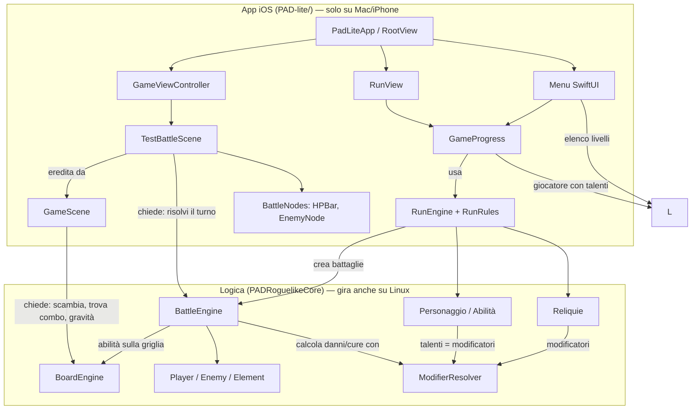
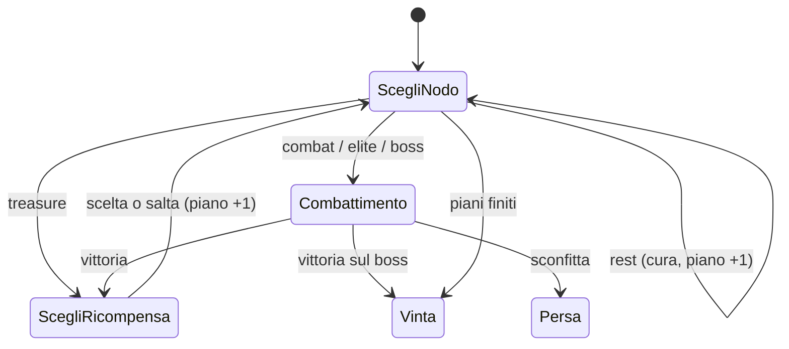
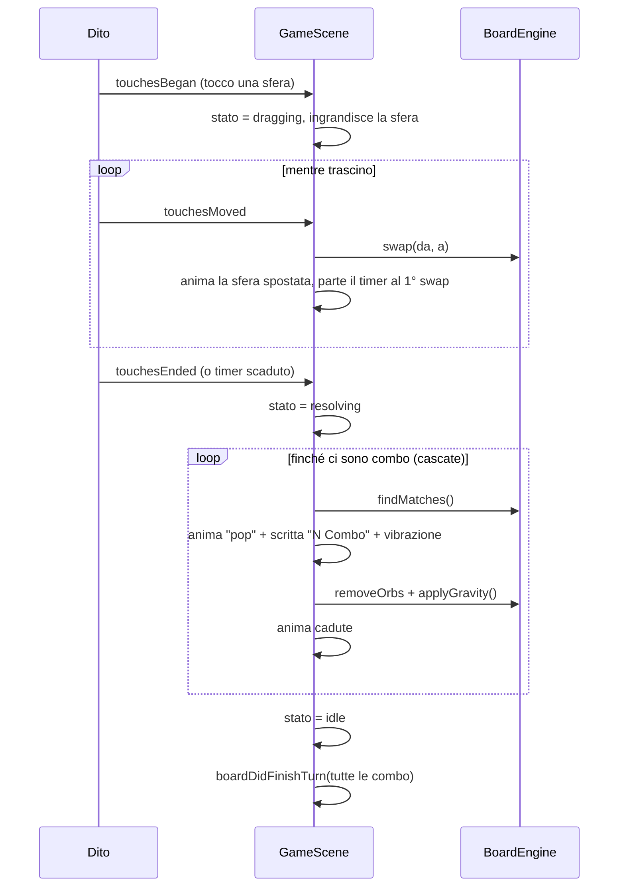
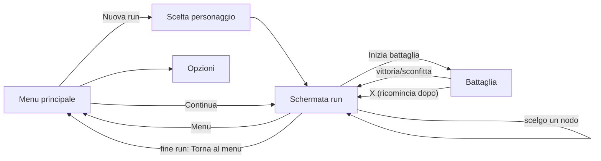

# Guida al codice (per chi non conosce Swift)

Questo progetto è un piccolo gioco iOS in stile **Puzzle & Dragons**: trascini una sfera ("orb") sulla griglia, la scambi con le vicine, e quando allinei 3+ sfere dello stesso colore fai una **combo**. Le combo infliggono danni ai nemici; se non li sconfiggi, loro ti attaccano.

---

## 1. Mappa del progetto

```
hello-world-ios/
├── project.yml                     ← ricetta per generare il progetto Xcode (tool "XcodeGen")
├── builder.json                    ← impostazioni della CI (nome progetto, scheme, bundle ID)
├── .github/workflows/              ← CI su GitHub: compila l'app su un Mac remoto
├── PAD-lite/                       ← L'APP iOS (grafica, tocchi, animazioni, menu)
│   ├── PadLiteApp.swift            ← punto di ingresso: mostra menu, schermata run o battaglia
│   ├── ContentView.swift           ← schermata di prova vecchia, NON usata dal gioco
│   ├── Assets.xcassets/            ← immagini dell'app (per ora solo l'icona)
│   │   └── AppIcon.appiconset/     ← metti qui AppIcon.png (1024×1024)
│   ├── Menu/                       ← schermate del menu (SwiftUI)
│   │   ├── GameProgress.swift      ← opzioni + run in corso (salvata automaticamente)
│   │   ├── MainMenuView.swift      ← menu principale: Continua / Nuova run / Opzioni
│   │   └── OptionsView.swift       ← tempo per mossa, vibrazione
│   ├── Run/                        ← schermate della run (SwiftUI)
│   │   ├── CharacterSelectView.swift ← scelta del personaggio
│   │   ├── RunView.swift           ← stato della run, scelta nodo, anteprima nemici, ricompense, fine run
│   │   └── RunTexts.swift          ← testi in italiano per nodi, reliquie, bonus, abilità
│   └── Game/
│       ├── GameViewController.swift ← crea la "tela" di gioco e calcola dove disegnare la griglia
│       ├── GameScene.swift          ← disegna la griglia, gestisce il trascinamento e le combo
│       ├── OrbArtwork.swift         ← colori e disegno delle sfere (grafica provvisoria)
│       ├── ComboHaptics.swift       ← vibrazione a ogni combo (più forte con più combo)
│       └── Battle/
│           ├── TestBattleScene.swift ← aggiunge nemici, abilità, barra HP, turni, vittoria/sconfitta
│           └── BattleNodes.swift     ← "pezzi grafici": barra HP, nemico, pulsante abilità, testo fluttuante
└── Packages/PADRoguelikeCore/      ← LA LOGICA PURA (regole, niente grafica)
    ├── Package.swift               ← configurazione della libreria
    ├── Sources/PADRoguelikeCore/
    │   ├── OrbModel.swift          ← tipi base: sfera, posizione, combo
    │   ├── BoardEngine.swift       ← regole della griglia: genera, scambia, trova combo, gravità, converti sfere
    │   ├── Modifiers/
    │   │   ├── Modifier.swift      ← i "mattoncini" di bonus (es. "fuoco ×1.5", "scudo a inizio turno")
    │   │   └── ModifierResolver.swift ← la "calcolatrice" che applica i bonus a danno/cura/difesa
    │   ├── Abilities/
    │   │   └── Ability.swift       ← abilità attive (cooldown, cariche, costo HP, effetti)
    │   ├── Characters/
    │   │   ├── Character.swift     ← il personaggio della run: statistiche, talenti passivi, abilità
    │   │   └── CharacterCatalog.swift ← i 5 personaggi tra cui scegliere
    │   ├── Relics/
    │   │   └── Relic.swift         ← reliquie e il loro catalogo
    │   ├── Run/
    │   │   ├── SeededRandom.swift  ← generatore casuale "riproducibile" (stesso seme = stessa run)
    │   │   ├── GameCatalog.swift   ← catalogo di tutto (reliquie, personaggi, nemici)
    │   │   ├── RunState.swift      ← lo stato salvabile della run
    │   │   ├── RunRules.swift      ← le regole della run (mappa, difficoltà, ricompense)
    │   │   └── RunEngine.swift     ← il "motore" che fa avanzare la run
    │   └── Combat/
    │       ├── Element.swift       ← elementi e vantaggi (fuoco batte legno, ecc.)
    │       ├── Player.swift        ← il giocatore (HP, attacco, cura)
    │       ├── Enemy.swift         ← i nemici (HP, attacco, conto alla rovescia)
    │       └── BattleEngine.swift  ← regole del combattimento a turni
    └── Tests/                      ← test automatici della logica
```

### L'idea chiave: due "strati" separati



- **Core** = il "cervello". Sa le regole, non sa disegnare. Si può testare su Linux con `swift test`.
- **App** = la "faccia". Disegna, anima, legge le dita. Chiede al core cosa succede.

Analogia: il core è l'arbitro con il regolamento, l'app è la telecamera che riprende la partita.

---

## 2. Swift in 10 minuti (solo quello che serve qui)

| Swift | Significato | Equivalente circa (JS/Python/Java) |
|---|---|---|
| `let x = 5` | costante (non cambia) | `const x = 5` |
| `var x = 5` | variabile | `let x = 5` (JS) |
| `x: Int` | "x è di tipo intero" | `int x` |
| `Int?` | "un intero **oppure niente** (`nil`)" — *optional* | `Integer` che può essere `null` |
| `[Int]` | array di interi | `List<int>` |
| `[OrbType: SKTexture]` | dizionario (mappa chiave → valore) | `dict` / `Map` |
| `func f(a: Int) -> Bool` | funzione che riceve un Int e ritorna un Bool | `def f(a): ...` |
| `struct` | oggetto "valore": copiato quando lo passi | come un record/dataclass |
| `class` | oggetto "riferimento": condiviso | classe normale Java/JS |
| `enum` | elenco di casi fissi | enum Java |
| `extension Tipo { ... }` | aggiunge metodi a un tipo già esistente | "monkey patching" pulito |
| `public` / `private` | visibile fuori dalla libreria / solo in questo file-tipo | idem Java |
| `private(set) var` | tutti possono leggere, solo il tipo può modificare | getter pubblico, setter privato |
| `self` | l'oggetto corrente | `this` |
| `init(...)` | costruttore | `constructor` / `__init__` |
| `mutating func` | metodo che modifica una `struct` | — |
| `override func` | ridefinisce un metodo della classe padre | `@Override` |

### Costrutti che vedrai spesso

**`guard ... else { return }`** — "se questa condizione NON è vera, esci subito".
```swift
guard state == .idle else { return }   // se non sono a riposo, non faccio niente
```

**`if let x = qualcosa`** — "se `qualcosa` non è nil, chiamalo `x` e usalo".
```swift
if let orb = engine.orb(at: pos) { ... }  // se in quella cella c'è una sfera...
```

**`switch`** — come un if/else multiplo, deve coprire tutti i casi.
```swift
switch self {
case .fire: "Fuoco"
case .water: "Acqua"
...
}
```

**Closure `{ ... }`** — funzione anonima (lambda). `$0` è il primo parametro.
```swift
enemies.allSatisfy { $0.isDefeated }  // "tutti i nemici sono sconfitti?"
```

**`.fire`, `.idle`** — il punto iniziale è una scorciatoia: Swift capisce il tipo dal contesto (`OrbType.fire`).

**`async` / `await`** — codice che "aspetta" senza bloccare l'app (serve per le animazioni in sequenza).
```swift
await wait(0.25)   // pausa di 0.25 secondi, poi continua
```

**`Task { ... }`** — fa partire un pezzo di codice asincrono.

**`[weak self]`** — evita che l'oggetto resti in memoria per sempre a causa della closure. Puoi ignorarlo concettualmente.

**`// MARK: - Qualcosa`** — solo un segnalibro per Xcode, non fa nulla.

**`///`** — commento di documentazione.

**`@MainActor`** — "questo codice gira sul thread principale" (obbligatorio per la grafica).

**`precondition(cond, "msg")`** — se `cond` è falsa, il programma si blocca con quel messaggio (controllo di sicurezza).

**`Sendable`, `Hashable`, `Equatable`, `Identifiable`, `CaseIterable`** — "etichette" (*protocolli*) che dicono cosa sa fare un tipo:
- `Equatable`: si può confrontare con `==`
- `Hashable`: si può usare come chiave di dizionario / in un `Set`
- `Identifiable`: ha un `id`
- `CaseIterable`: per un enum, dà `allCases` (lista di tutti i casi)
- `Sendable`: sicuro da passare tra thread
- `Codable`: si può trasformare in JSON e ricostruire (serve per i salvataggi)

**`throws(Errore)` / `try`** — una funzione che può fallire con un errore preciso; chi la chiama scrive `try`.
```swift
try battle.useAbility(0)   // può fallire con AbilityError.onCooldown, ecc.
```

**`protocol`** — un "contratto": elenco di funzioni che un tipo promette di avere (come un'interfaccia Java). Es. `RunRules`.

**`case let .x(a, b) where condizione`** — in uno `switch`, "se è il caso `x`, estrai i valori `a` e `b`, ma solo se la condizione è vera".

### SwiftUI (usato per i menu)

SwiftUI descrive l'interfaccia come "cosa voglio vedere" e la ridisegna da sola quando i dati cambiano.

- **`struct X: View { var body: some View { ... } }`**: una schermata o un pezzo di schermata. `body` dice cosa mostrare.
- **`VStack` / `HStack`**: impila elementi in verticale / orizzontale. **`List`** / **`Form`**: elenchi stile Impostazioni.
- **`Text`, `Button`, `Toggle`, `Stepper`, `Image(systemName:)`**: testo, pulsante, interruttore, +/-, icona di sistema.
- **`NavigationStack` + `NavigationLink`**: navigazione a pagine con il tasto "indietro" automatico.
- **`.font(...)`, `.padding()`, `.disabled(...)`**: "modificatori" che cambiano l'aspetto o il comportamento.
- **`@State`**: una variabile della schermata; quando cambia, la schermata si ridisegna.
- **`@Observable class`**: un oggetto di dati "osservato": se cambia, le schermate che lo usano si aggiornano.
- **`.environment(obj)` / `@Environment(Tipo.self)`**: passa un oggetto a tutte le schermate "figlie" senza doverlo passare a mano.
- **`@Bindable` e `$valore`**: collegamento a due vie (es. un `Toggle` che legge **e** scrive un'opzione).

---

## 3. Il Core (la logica) file per file

### 3.1 `OrbModel.swift` — i mattoncini

- **`OrbType`**: i 6 colori di sfera: `fire, water, wood, light, dark, heal`.
- **`GridPosition`**: una cella `(col, row)`. **Attenzione: `row 0` è in BASSO** (come in matematica, non come in Excel).
  - `isAdjacent(to:)`: vero se l'altra cella è una delle 8 intorno (diagonali comprese).
- **`Orb`**: una sfera = `id` univoco + `type`. L'id serve all'app per sapere quale disegno muovere.
- **`MatchCluster`**: una **combo** = tipo + lista di posizioni + id delle sfere coinvolte.
- **`OrbFall`**: "la sfera X cade da qui a lì".
- **`OrbSpawn`**: "nasce una sfera nuova in questa cella" (`stackIndex` = quanto in alto partire per l'animazione).
- **`GravityResult`**: elenco di cadute + nascite dopo una combo.

### 3.2 `BoardEngine.swift` — le regole della griglia

È una `class` che contiene `grid`, cioè una matrice `grid[riga][colonna]` di `Orb?` (sfera o vuoto).

| Metodo | Cosa fa |
|---|---|
| `init(cols:rows:)` | Crea una griglia (default 6×5) e la riempie a caso. |
| `init(layout:)` | Crea una griglia fissa (usato nei test). |
| `generateBoard()` | Riempie la griglia **evitando** che ci siano già 3 in fila all'inizio: per ogni cella esclude il colore che formerebbe un tris con le due a sinistra o le due sotto. |
| `swap(a, b)` | Scambia due sfere vicine. Ritorna `false` se non valido. |
| `findMatches()` | Trova tutte le combo (vedi sotto). |
| `removeOrbs(in:)` | Svuota le celle delle combo. |
| `applyGravity()` | Fa cadere le sfere nei buchi e ne crea di nuove in cima ("skyfall"). |
| `convertOrbs(from:to:)` | Trasforma tutte le sfere di un tipo in un altro (usato dalle abilità). Le sfere nuove hanno id nuovi. |

**Come funziona `findMatches()`** (in 3 passaggi):
1. Scorre ogni **riga**: se trova 3+ dello stesso tipo di fila, le "marca".
2. Scorre ogni **colonna**: stessa cosa.
3. Raggruppa le celle marcate che si toccano (su/giù/destra/sinistra) **e** sono dello stesso tipo → una sola combo. Così una forma a L, T o + conta come **1 combo** sola. (Tecnica: *BFS*, una "macchia d'olio" che si espande dalle celle vicine.)

**Come funziona `applyGravity()`**: per ogni colonna, dal basso verso l'alto, sposta in giù ogni sfera trovata (puntatore `write` = prima cella libera). Le celle rimaste vuote in cima vengono riempite con sfere casuali.

**`randomIndex`**: la funzione che genera numeri casuali è "iniettabile": nei test si passa una funzione prevedibile, così i risultati sono sempre uguali.

### 3.3 `Element.swift` — sasso/carta/forbici

- **`Element`**: `fire, water, wood, light, dark` (niente heal).
- `multiplier(against:)`:
  - **×2** se vantaggio: fuoco→legno, legno→acqua, acqua→fuoco, luce↔buio
  - **×0.5** se svantaggio: il contrario del triangolo
  - **×1** altrimenti
- `OrbType.element`: converte un colore di sfera in elemento; per `heal` ritorna `nil` (la sfera cura invece di attaccare).

### 3.4 `Player.swift` — il giocatore

- `maxHP`, `currentHP`
- `attack`: dizionario elemento → danno base (es. fuoco 1000)
- `recovery`: cura base (300)
- `takeDamage` / `heal`: modificano gli HP senza andare sotto 0 o sopra il massimo, e ritornano quanto è cambiato davvero.
- `init(..., currentHP:)`: si può creare un giocatore già ferito (serve alla run per portare i danni da una battaglia all'altra).
- `Player.test`: giocatore preconfezionato per le prove.

### 3.5 `Enemy.swift` — i nemici

- `name`, `element`, `maxHP`, `currentHP`, `attackPower`
- `turnInterval`: ogni quanti turni attacca
- `turnCountdown`: turni rimasti al prossimo attacco
- `advanceTurn()`: scala il countdown di 1; quando arriva a 0 ritorna `true` (= attacca) e riparte da `turnInterval`.
- `delay(by:)`: allunga il countdown (usato dalle abilità che "ritardano" i nemici).
- `Enemy.testRoster`: Slime (legno), Golem (acqua), Drago (fuoco).

### 3.6 `BattleEngine.swift` — il combattimento

Tipi di supporto:
- `EncounterMode`: `.simultaneous` (tutti i nemici in campo) o `.sequential` (uno alla volta).
- `BattleOutcome`: `.ongoing` (in corso), `.victory`, `.defeat`.
- `CombatRules`: i bonus (+25% per ogni combo extra, +25% per ogni sfera oltre la terza).
- `PlayerAttack`, `EnemyAttack`, `TurnReport`: il "verbale" di cosa è successo nel turno (l'app lo usa per animare).

Metodi principali:
- `activeEnemyIndices`: quali nemici sono in gioco ora.
- `targetIndex` / `selectTarget(_:)`: nemico bersaglio (scelto dal giocatore toccandolo, altrimenti il primo vivo).
- **`resolveTurn(clusters:)`**: il cuore del gioco, vedi sotto.
- **`useAbility(_:board:)`**: usa un'abilità prima della mossa (vedi 3.8).
- `resolver`: la calcolatrice dei bonus (modificatori permanenti + buff temporanei, vedi 3.7).
- `shield`: scudo attuale; assorbe i danni nemici prima degli HP.
- `reset()`: riporta tutto allo stato iniziale.

#### La formula del danno

$$
\text{danno} = \text{attacco}_{elem} \times \underbrace{\left(1 + 0.25 \cdot (\text{sfere} - 3)\right)}_{\text{bonus sfere}} \times \underbrace{\left(1 + 0.25 \cdot (\text{combo} - 1)\right)}_{\text{bonus combo}} \times \text{vantaggio elemento}
$$

**Esempio**: fai 2 combo nel turno; una è di 4 sfere fuoco, il bersaglio è lo Slime (legno).
- bonus sfere = 1 + 0.25·1 = 1.25
- bonus combo = 1 + 0.25·1 = 1.25
- vantaggio = ×2 (fuoco batte legno)
- danno = 1000 × 1.25 × 1.25 × 2 = **3125**

Le combo di sfere **heal** invece curano: `recovery × bonus sfere × bonus combo`.

Con reliquie/talenti la formula si allarga (vedi 3.7): senza modificatori il risultato è identico a quello sopra.

#### Ordine di un turno (`resolveTurn`)
1. Se la battaglia è già finita, non fa nulla.
2. **Inizio turno**: scudi e cure "a inizio turno" dei modificatori.
3. Per ogni combo: se è un elemento → danno al bersaglio; se è heal → cura (passando dal `ModifierResolver`).
4. **Trigger combo**: se hai fatto abbastanza combo, scatta lo scudo "su combo".
5. Ogni nemico attivo (che era in campo già a inizio turno) avanza il countdown; chi arriva a 0 attacca: il danno viene **ridotto** (riduzione danni), poi lo **scudo** ne assorbe una parte, il resto toglie HP.
6. Fine turno: i buff temporanei perdono 1 turno, i cooldown delle abilità scendono di 1.
7. Ritorna il `TurnReport`, che ora contiene anche `shieldGained` e `appliedModifiers` (l'elenco di **quali** bonus sono scattati e da dove vengono).

### 3.7 Modificatori e reliquie (`Modifiers/`, `Relics/`)

L'idea: **reliquie, talenti dei personaggi e buff delle abilità parlano tutti la stessa lingua**: una lista di `Modifier`. Una sola "calcolatrice" (`ModifierResolver`) li applica. Così aggiungere una reliquia nuova = scrivere una riga di dati, senza toccare il combattimento.

**`Modifier`** — i tipi di bonus disponibili:

| Modificatore | Effetto |
|---|---|
| `flatDamage(element:amount:)` | +N all'attacco base (di un elemento o di tutti se `nil`) |
| `damageMultiplier(element:factor:)` | danno finale × fattore |
| `comboBonus(x)` | ogni combo extra vale +x in più (normale: +25%) |
| `orbBonus(orb:amount:)` | ogni sfera oltre la 3ª vale +x in più |
| `flatHeal(n)` / `healMultiplier(x)` | cura +N / cura × x |
| `maxHPMultiplier(x)` | HP massimi × x |
| `damageReduction(x)` | danni subiti −x (totale massimo 75%) |
| `shieldOnTurnStart(n)` / `healOnTurnStart(n)` | a ogni turno: +N scudo / +N HP |
| `shieldOnCombo(minCombos:amount:)` | se fai almeno N combo: +scudo |
| `damageOnCombo(minCombos:factor:)` | se fai almeno N combo: tutto il danno × fattore |

**`ModifierSource`** = un gruppo di modificatori con un **nome** (es. la reliquia "Brace Eterna"). Il nome serve per capire chi ha dato quale bonus.

**`ModifierResolver`** — l'ordine è **fisso** (quindi il risultato non cambia se le reliquie sono in ordine diverso):

$$
\text{danno} = (\text{attacco} + \text{bonus fissi}) \times \text{bonus sfere} \times \text{bonus combo} \times \text{vantaggio elemento} \times \prod \text{moltiplicatori}
$$

Ogni calcolo ritorna un `Resolved`: il **valore** + l'elenco `applied` dei modificatori usati ("ispezionabile": puoi mostrare al giocatore *perché* ha fatto quel danno).

**Esempio**: attacco fuoco 1000, reliquie "fuoco ×1.5", "+100 attacco", "+25% per combo extra"; 2 combo, bersaglio legno:
(1000 + 100) × 1 × 1.5 (combo: 1 + 0.5) × 2 (vantaggio) × 1.5 = **4950**.

**`Relic`**: `id`, `name`, `rarity` (comune/rara/leggendaria), `modifiers`. Catalogo in `Relic.standard` (10 reliquie, es. "Brace Eterna" fuoco ×1.5, "Scudo di Quercia" +150 scudo a turno, "Corona del Caos" bonus a 4-5 combo).

### 3.8 Abilità attive (`Abilities/Ability.swift`)

- **`Ability`**: `name`, `cooldown` (mosse di attesa dopo l'uso), `charges` (usi per battaglia, `nil` = infiniti), `hpCost` (HP da pagare), `effects`.
- **`AbilityEffect`** — cosa può fare:
  - `damage(target:element:multiplier:)`: danno al bersaglio o a tutti (`attacco elemento × moltiplicatore × vantaggio`; **non** usa le reliquie)
  - `healPercent(x)`: cura una % degli HP massimi
  - `shield(n)`: +scudo
  - `delayEnemies(turns:)`: i nemici attaccano N turni dopo
  - `buff(source, turns:)`: modificatori temporanei per N mosse (compresa quella attuale)
  - `convertOrbs(from:to:)`, `refreshBoard`: agiscono sulla **griglia** (serve passare il `BoardEngine`)
- **`AbilityState`**: l'abilità dentro una battaglia, con proprietario, cooldown rimasto e cariche rimaste. `isReady` = usabile ora.
- **`useAbility`** può fallire con `AbilityError`: `onCooldown`, `noCharges`, `notEnoughHP` (non puoi suicidarti col costo), `needsBoard`, `battleOver`, `invalidIndex`.
- Ritorna un `AbilityReport` (danni, cure, scudo, nemici ritardati, sfere convertite) per le animazioni.

**Cooldown in pratica**: abilità con cooldown 2 usata al turno 1 → di nuovo pronta al turno 3.

### 3.9 Il personaggio (`Characters/`)

Ogni run si gioca con **un solo personaggio**, scelto all'inizio. Niente party, niente reclutamento.

- **`CharacterDefinition`**: `name`, `element`, statistiche base (HP, attacco, cura), `talents` (passivi), `abilities` (attive, possono essere più di una).
  - Livelli 1–5: ogni livello sopra l'1 dà **+10%** a tutte le statistiche. Si sale di livello con la ricompensa `levelUp`.
  - Il personaggio attacca con **tutti** i colori di sfera (stesso attacco base), ma il **suo elemento** ha l'**affinità**: danno **×1.5**. L'affinità è un normale modificatore ("Kael: Affinità"), quindi compare anche nella traccia del resolver.
- **`PassiveTalent`**: nome + livello di sblocco + modificatori. Si attiva quando il personaggio raggiunge quel livello.
- Funzioni utili:
  - `makePlayer(level:resolver:missingHP:)`: crea il `Player` usato dal combattimento (stesso attacco per ogni elemento).
  - `modifierSources(at: livello)`: affinità + talenti sbloccati a quel livello, chiamati "Personaggio: Talento".
  - `abilityStates`: le abilità pronte per una battaglia.

**Esempio**: Kael livello 1 (attacco 900, Brace +100 fuoco), 3 sfere fuoco contro un nemico neutro: (900 + 100) × 1.5 = **1500**. Con 3 sfere acqua: **900**.

I 5 personaggi (`CharacterDefinition.standard`):

| Nome | Elemento | HP / Attacco / Cura | Talenti (livello) | Abilità |
|---|---|---|---|---|
| Kael | Fuoco | 4000 / 900 / 250 | Brace: +100 attacco fuoco (1) · Furia: ×1.2 a 4+ combo (3) | Esplosione: 6× danno fuoco al bersaglio (cd 4) |
| Nerea | Acqua | 4200 / 850 / 300 | Marea: +10% per sfera extra acqua (1) · Risacca: +150 HP a turno (3) | Onda: fuoco → acqua sulla griglia (cd 5) |
| Sylas | Legno | 5000 / 750 / 250 | Corteccia: −10% danni (1) · Radici: +400 scudo a 3+ combo (3) | Barriera: +1500 scudo (cd 4) |
| Lumen | Luce | 3800 / 800 / 450 | Grazia: cura ×1.25 (1) · Aura: HP ×1.1 (3) | Benedizione: cura 35% + buio → cuori (cd 5) |
| Umbra | Buio | 3500 / 1000 / 200 | Ombra: +5% per combo extra (1) · Patto: tutto il danno ×1.1 (3) | Eclissi: ritarda i nemici + buio ×2 per 1 turno (cd 3, 2 cariche, costa 300 HP) |

### 3.10 La run roguelike (`Run/`)

Una **run** è una partita completa: una serie di **piani** (floor). A ogni piano scegli un **nodo** tra alcune opzioni; l'ultimo piano è sempre il **boss**.



- **`NodeKind`**: `combat` (nemici normali), `elite` (nemico forte, ricompense migliori), `rest` (cura), `treasure` (scegli una reliquia), `boss`.
- **`Reward`**: `relic` (nuova reliquia), `levelUp` (+1 livello al personaggio), `heal` (cura una %).
- **`RunState`**: **tutto** lo stato della run (piano, fase, personaggio e suo livello, reliquie, HP persi, generatore casuale). È `Codable`: si salva in JSON e si ricarica esattamente dov'era.
  - Gli HP sono salvati come **HP persi** (`missingHP`): così se gli HP massimi cambiano (level-up, reliquia) i danni subiti restano coerenti.
- **`SeededRandom`**: generatore casuale con "seme". Stesso seme + stesse scelte = **stessa identica run** (utile per test, replay, "sfida del giorno").
- **`RunEngine`** — i comandi:
  - `RunEngine(seed:characterID:)` nuova run (es. `characterID: "kael"`) · `RunEngine(restoring:)` riprende un salvataggio
  - `chooseNode(i)` → sceglie il nodo
  - `makeBattle()` → crea il `BattleEngine` con personaggio, reliquie, talenti, abilità e HP attuali
  - `finishBattle(battle)` → registra il risultato (gli HP persi restano per la prossima battaglia)
  - `chooseReward(i)` (o `nil` per saltare)
  - Se chiami un comando nella fase sbagliata: errore `RunError.wrongPhase`.
- **`RunRules`** — i "ganci" (hook) per cambiare le regole **senza toccare il motore**: quali nodi offrire, quali nemici, come crescono HP/attacco dei nemici, quali ricompense. `StandardRunRules` è la versione di default:
  - 8 piani, 3 scelte per piano (piano 0 sempre combattimento, ultimo sempre boss, elite dal piano 2)
  - HP nemici **+20% per piano**, attacco **+12% per piano**
  - combattimenti normali: 1 nemico al piano 0, fino a 3 più avanti
  - ricompense combattimento: 2 reliquie + 1 level-up (o una cura se sei già al livello massimo); l'elite offre reliquie almeno rare
- **`GameCatalog`**: tutto ciò che la run può usare (reliquie, personaggi selezionabili, `EnemyTemplate` dei nemici). I salvataggi contengono solo gli **id**, che vengono cercati qui.

> Nell'app questi sistemi sono usati dalle schermate in `PAD-lite/Run/` e dalla battaglia (vedi 4.7). La vecchia campagna a livelli e i talenti del menu sono stati **rimossi**: ora si gioca solo a run.

---

## 4. L'App (grafica e input) file per file

Usa **SpriteKit**, il motore 2D di Apple. Concetti base:
- **`SKScene`**: la "scena", una tela che si ridisegna ~60-120 volte al secondo.
- **`SKNode`**: qualsiasi oggetto nella scena (può contenere altri nodi, come cartelle).
- **`SKSpriteNode`** (immagine/rettangolo), **`SKShapeNode`** (forma: cerchio, rettangolo), **`SKLabelNode`** (testo).
- **`SKAction`**: un'animazione (muovi, scala, sfuma, aspetta...). Si possono mettere in `sequence` (una dopo l'altra) o `group` (insieme).
- **`zPosition`**: chi sta sopra a chi (numero più alto = più in primo piano).
- **Coordinate**: in SpriteKit **y cresce verso l'alto** (origine in basso a sinistra).

### 4.1 `PadLiteApp.swift` — si parte da qui
`@main` = "questo è l'inizio del programma".
- Crea **un solo** `GameProgress` (opzioni + run salvata) e lo rende disponibile a tutte le schermate con `.environment(...)`.
- **`RootView`** decide cosa mostrare:
  - c'è una battaglia attiva (`activeBattle`) → la **battaglia** (`GameView`) a schermo intero, con una **X** in alto a destra per uscire (la run resta su quello scontro: rientrando, la battaglia **ricomincia** da capo)
  - altrimenti, se stai guardando la run (`showingRun`) → **`RunView`**
  - altrimenti → il **menu** (`MainMenuView`)
- A fine battaglia (tocco sulla schermata VITTORIA/SCONFITTA) passa il risultato alla run (`progress.finishBattle`) e torna alla `RunView`.

### 4.2 `GameViewController.swift` — il contenitore
- Riceve un `BattleEngine` già pronto (creato dalla run con personaggio, reliquie, abilità e HP attuali), le **opzioni** e cosa fare a fine battaglia (`onBattleEnd`).
- Crea il `BoardEngine` (6×5) e la `TestBattleScene`.
- `loadView()`: crea la `SKView` (la superficie dove SpriteKit disegna).
- `viewDidLayoutSubviews()`: chiamato quando cambia la dimensione dello schermo; calcola il `BoardLayout` (dove mettere la griglia e quanto grandi le celle) e lo passa alla scena.
- `boardLayout(...)`: mette la griglia nella **metà inferiore** dello schermo, centrata, con celle quadrate il più grandi possibile.
- `GameView`: un "adattatore" per usare questo controller (stile UIKit, vecchio) dentro SwiftUI (stile nuovo).

### 4.3 `GameScene.swift` — la griglia giocabile
È la classe base. Ha 3 stati: `idle` (fermo), `dragging` (stai trascinando), `resolving` (sta calcolando/animando le combo).

Impostazioni (modificabili dalle Opzioni):
- `moveDuration` → secondi a disposizione per muovere (default 5)
- `hapticsEnabled` → vibrazione accesa/spenta

Costanti utili da modificare per "tarare" il gioco:
- `Timing.comboInterval`, `pop`, ecc. → velocità animazioni
- `Tuning.swapZone` → quanto devi avvicinarti al centro di una cella per scambiare

Flusso dell'input:



Dettagli:
- `orbNodes`: dizionario **id sfera → disegno**. Così, quando il core dice "la sfera 42 cade", l'app sa quale disegno muovere.
- `trackDrag`: se il dito salta più celle in un colpo, cammina una cella alla volta, così ogni scambio è sempre tra vicine.
- `update(_:)`: chiamato ogni frame; aggiorna la barra del tempo (verde → giallo → rossa) e chiude la mossa allo scadere.
- **Hook per sottoclassi** (metodi vuoti pensati per essere ridefiniti):
  - `boardLayoutDidChange(...)`: "ho ridisegnato la griglia, ecco lo spazio libero sopra"
  - `boardDidFinishTurn(...)`: "il giocatore ha finito la mossa, ecco le combo"
- `engine`: la griglia, visibile anche alla sottoclasse (serve alle abilità che cambiano le sfere).
- `reloadOrbs()`: ridisegna tutte le sfere leggendo la griglia, con un piccolo "pop" (usato dopo un'abilità che converte le sfere).
- In fondo: `makeOrbTextures` / `makeOrbNode` creano i disegni delle sfere usando `OrbArtwork` (vedi 4.9).

### 4.4 `TestBattleScene.swift` — la battaglia
`class TestBattleScene: GameScene` = **eredita** tutto da `GameScene` e aggiunge la battaglia.

- `boardLayoutDidChange` (override): nello spazio sopra la griglia piazza (dall'alto) scritta del turno, nemici affiancati, **riga di pulsanti abilità**, barra HP del giocatore.
- `touchesBegan` (override): se c'è la schermata di fine, chiama `onBattleEnd`; se tocchi un nemico lo seleziona come bersaglio; se tocchi un'**abilità** la usa; altrimenti passa il tocco alla griglia (`super.touchesBegan`).
- `useAbility(i)` / `playAbility(report)`: chiama `battle.useAbility(i, board: engine)` (se non è pronta non succede nulla), poi anima: sfere ridisegnate se cambiate, colpi sui nemici, cura, aggiornamento di HP/scudo/cooldown; se l'abilità chiude la battaglia mostra il risultato.
- `boardDidFinishTurn` (override): blocca l'input, chiama `battle.resolveTurn(...)`, poi `play(report)`.
- `play(report)`: anima nell'ordine: colpi del giocatore → cura → attacchi nemici → controlla vittoria/sconfitta.
- `refresh`: allinea la grafica allo stato reale del `BattleEngine` (nemici, barra HP, pulsanti abilità, scritta "Turno N · Scudo X").
- `showOutcome`: schermata "VITTORIA!" / "SCONFITTA".
- `restartBattle`: resetta battaglia e griglia.
- In fondo, `array[safe: i]`: accesso ad array che ritorna `nil` invece di crashare se l'indice non esiste.

### 4.5 `BattleNodes.swift` — componenti grafici
- `Element.displayName`: nomi in italiano ("Fuoco", "Acqua"...).
- **`HPBarNode`**: barra della vita con testo "attuale / massimo". `set(...)` la aggiorna (con animazione opzionale).
- **`EnemyNode`**: un nemico disegnato = cerchio colorato per elemento + nome + barra HP + "Attacco: N" + anello giallo pulsante se è il bersaglio.
  - `update(...)`: aggiorna testo/trasparenza (sconfitto = quasi trasparente, "In attesa" = semi-trasparente).
  - `contains(pointInParent:)`: il tocco è sopra questo nemico?
  - `showHit`: scuote il nemico e mostra il numero del danno.
  - `playAttack`: piccolo "balzo" quando attacca.
- **`AbilityButtonNode`**: pulsante di un'abilità con nome e stato: "Pronta" (bordo dorato, con cariche rimaste e costo HP se ci sono), "Ricarica: N" o "Esaurita" (sbiadito).
- **`FloatingText.spawn`**: numerino che sale e svanisce (es. "-3125", "+300").

### 4.6 `ContentView.swift`
Schermata di prova precedente (testo + angolo della cerniera per dispositivi pieghevoli). **Non è usata**.

### 4.7 `Menu/` e `Run/` — le schermate (SwiftUI)



- **`GameProgress.swift`**: la "memoria" dell'app, salvata in `UserDefaults` (un piccolo archivio chiave → valore che sopravvive alla chiusura dell'app).
  - `settings` (`GameSettings`): tempo per mossa e vibrazione.
  - `run`: il `RunEngine` della run in corso (o `nil`).
  - `runState`: copia dello stato della run, aggiornata dopo ogni azione: serve a SwiftUI per accorgersi dei cambiamenti (il `RunEngine` da solo non "avvisa").
  - Azioni: `startRun(characterID:)`, `chooseNode`, `makeBattle`, `finishBattle`, `chooseReward`, `endRun`. Dopo ognuna la run viene **salvata in JSON** automaticamente: chiudi l'app e la ritrovi con "Continua".
  - All'avvio ricarica la run salvata (se il salvataggio non è leggibile, lo ignora).
- **`MainMenuView.swift`**: titolo, **Continua** (solo se c'è una run, con personaggio, livello e piano), **Nuova run**, **Opzioni**.
- **`CharacterSelectView.swift`**: i 5 personaggi con elemento, statistiche, talenti (con livello di sblocco) e abilità. "Gioca con …" avvia la run; se ce n'è già una chiede conferma (andrebbe persa).
- **`RunView.swift`**: in alto personaggio, livello, piano e barra HP; in basso le reliquie raccolte. Al centro cambia in base alla **fase** della run:
  - scelta del nodo → lista di tappe (icona, nome, descrizione)
  - combattimento → anteprima dei nemici (HP, attacco, ogni quanti turni attaccano) + **Inizia battaglia**
  - ricompensa → lista di scelte (reliquia con rarità ed effetti, livello con talenti sbloccati, cura) + **Salta**
  - vittoria/sconfitta → risultato + **Torna al menu** (chiude la run)
- **`RunTexts.swift`**: traduce in italiano i tipi del core (nomi dei nodi, rarità, descrizione di ogni `Modifier` e `AbilityEffect`, riassunto delle abilità) e dà un colore SwiftUI a ogni elemento.
- **`OptionsView.swift`**: Stepper per il tempo per mossa (3–10 s) e interruttore per la vibrazione.

### 4.8 Icona dell'app
- Va messa in `PAD-lite/Assets.xcassets/AppIcon.appiconset/AppIcon.png`: **1024×1024**, quadrata, senza trasparenza, senza angoli arrotondati (li aggiunge iOS).
- `Contents.json` nella stessa cartella descrive le varianti (chiara, scura, "tinted"); scura e tinted sono facoltative.
- In `project.yml` la riga `ASSETCATALOG_COMPILER_APPICON_NAME: AppIcon` dice a Xcode quale icona usare.
- La CI **non** crea queste cartelle: devono essere nel repository.

### 4.9 `OrbArtwork.swift` e `ComboHaptics.swift` — pezzi separati da `GameScene`
Sono stati tolti da `GameScene.swift` per renderlo più corto e leggibile; non dipendono dallo stato della griglia.
- **`OrbArtwork.swift`**: `baseColor` / `rimColor` (colore e bordo di ogni tipo di sfera) e `OrbArtwork.node(...)`, che disegna una sfera come cerchio + riflesso + simbolo (fiamma, goccia, foglia, stella, anello, cuore). `GameScene` la "fotografa" una volta in una texture per tipo, così il disegno è veloce.
- **`ComboHaptics.swift`**: classe `ComboHaptics` con `prepare()` (accende il motore di vibrazione all'avvio della scena) e `play(combo:)` (un colpetto, più intenso a ogni combo). Sui dispositivi senza vibrazione non fa nulla.

---

## 5. Il giro completo, in parole povere

1. L'app parte → `PadLiteApp` carica opzioni ed eventuale run salvata (`GameProgress`) e mostra il **menu**.
2. **Nuova run** → scegli il personaggio → parte un `RunEngine` con un seme casuale → `RunView`.
3. Scegli una tappa: riposo (cura) e tesoro (reliquia) si risolvono subito; combattimento/elite/boss mostrano i nemici.
4. **Inizia battaglia** → la run crea il `BattleEngine` (personaggio + reliquie + talenti + abilità + HP attuali) → `GameView` → `GameViewController` crea griglia e scena.
5. Prima di muovere puoi toccare un **pulsante abilità** (se è pronta).
6. Tocchi una sfera e la trascini → `GameScene` chiede a `BoardEngine` di scambiare.
7. Lasci (o scade il tempo) → `GameScene` cerca combo, le fa esplodere, fa cadere le sfere, ripete finché non ci sono più combo.
8. `TestBattleScene` riceve le combo → `BattleEngine.resolveTurn` calcola danni (con i bonus), cure, scudi, attacchi nemici.
9. La scena anima il risultato. Se la battaglia continua, si torna al punto 5.
10. A fine battaglia tocchi lo schermo → la run registra il risultato (gli HP persi restano) → `RunView`: scegli una ricompensa e si passa al piano successivo.
11. Sconfitta o boss battuto → schermata di fine run → **Torna al menu**.

---

## 6. Dove mettere le mani

| Voglio... | File | Cosa cambiare |
|---|---|---|
| Tempo per muovere di default | `GameProgress.swift` | `GameSettings.moveDuration` |
| Range del tempo nelle Opzioni | `OptionsView.swift` | `in: 3...10` |
| Griglia più grande | `GameViewController.swift` | `BoardEngine(cols: 6, rows: 5)` |
| Bonus combo diversi | `BattleEngine.swift` | `CombatRules` (valori di default) |
| Nuova reliquia | `Relic.swift` | una riga in `Relic.standard` |
| Nuovo tipo di bonus | `Modifier.swift` + `ModifierResolver.swift` | nuovo `case` + dove applicarlo |
| Nuovo personaggio | `CharacterCatalog.swift` | una voce in `CharacterDefinition.standard` |
| Forza dell'affinità elementale | `Character.swift` | `affinityMultiplier` |
| Nuovo effetto di abilità | `Ability.swift` + `BattleEngine.useAbility` | nuovo `case` in `AbilityEffect` + cosa fa |
| Difficoltà della run | `RunRules.swift` | `hpGrowthPerFloor`, `attackGrowthPerFloor`, `floorCount` |
| Nemici della run | `GameCatalog.swift` | `EnemyTemplate.standard` |
| Regole completamente diverse | nuovo tipo che implementa `RunRules` | passarlo a `RunEngine(..., rules:)` |
| Testi/descrizioni in italiano | `RunTexts.swift` | `title`, `summary`, `displayText` |
| Icone dei nodi della run | `RunTexts.swift` | `NodeKind.symbol` (nomi SF Symbols) |
| Colori delle sfere | `OrbArtwork.swift` | `baseColor` / `rimColor` |
| Forza della vibrazione combo | `ComboHaptics.swift` | `intensity` in `play(combo:)` |
| Icona dell'app | `Assets.xcassets/AppIcon.appiconset/` | `AppIcon.png` |

---

## 7. Come provarlo

- **Logica (anche su Linux)**: dalla cartella `Packages/PADRoguelikeCore` esegui `swift test`. I test sono in `Tests/PADRoguelikeCoreTests/` (`RoguelikeSystemsTests.swift` copre reliquie, abilità, personaggi e run).
- **App completa**: serve un Mac con Xcode. Genera il progetto con `xcodegen` (legge `project.yml`), aprilo in Xcode e avvialo su simulatore o iPhone.
- **Senza Mac**: la CI in `.github/workflows/` (`ios-build.yml` per compilare, `ios-share.yml` per provare l'app in un simulatore remoto) esegue `xcodegen` e compila su un Mac di GitHub.

---

## 8. Glossario rapido

- **Orb / sfera**: la pallina colorata sulla griglia.
- **Combo / cluster**: gruppo di 3+ sfere uguali collegate.
- **Cascata / skyfall**: nuove sfere che cadono dall'alto e possono creare altre combo "gratis".
- **Engine**: classe con la logica pura (`BoardEngine`, `BattleEngine`).
- **Scene / Node**: oggetti grafici di SpriteKit.
- **Haptics**: vibrazioni del telefono.
- **Safe area**: zona dello schermo non coperta da notch, angoli arrotondati, barra home.
- **SwiftUI**: sistema di Apple per costruire interfacce (usato per i menu).
- **UserDefaults**: archivio semplice dove l'app salva dati che restano dopo la chiusura.
- **Talento**: bonus passivo del personaggio, si sblocca a un certo livello (1–5).
- **Asset catalog (`.xcassets`)**: cartella delle immagini dell'app, icona compresa.
- **Run**: una partita roguelike completa, dal primo piano al boss (o alla sconfitta).
- **Nodo / piano (floor)**: una tappa della run / un "livello" della mappa.
- **Reliquia**: oggetto raccolto nella run che dà bonus permanenti fino a fine run.
- **Modificatore**: un singolo bonus tipizzato (es. "fuoco ×1.5").
- **Resolver**: il pezzo di codice che applica tutti i modificatori in un ordine fisso.
- **Buff**: bonus temporaneo (dura qualche turno).
- **Cooldown / cariche**: turni di attesa tra due usi / numero massimo di usi.
- **Seme (seed)**: numero da cui parte il generatore casuale; stesso seme = stessa sequenza.
- **Codable**: "si può salvare e ricaricare" (es. in JSON).
- **Hook**: punto previsto per inserire regole personalizzate.
