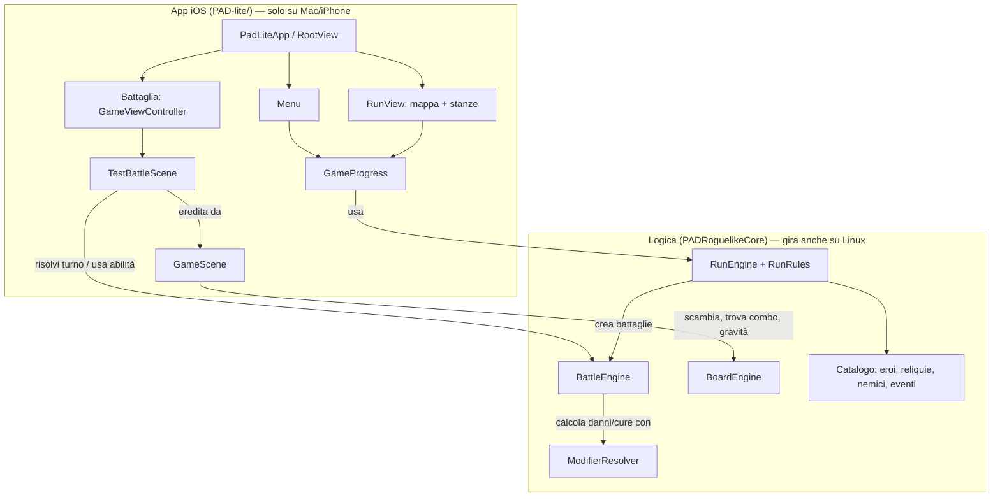
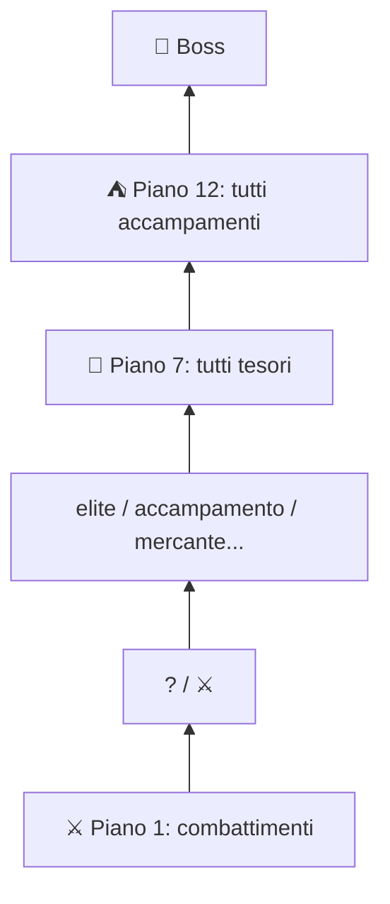
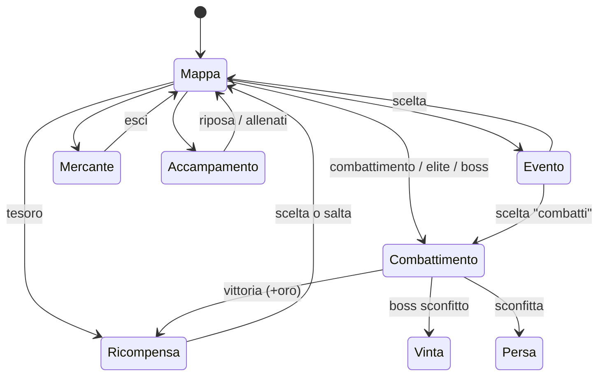
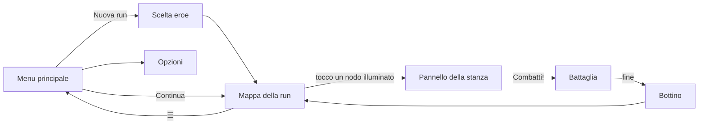

# Guida al codice (per chi non conosce Swift)

**PAD-lite** è un gioco iOS che unisce due idee:
- il **puzzle** di *Puzzle & Dragons*: trascini una sfera ("orb") sulla griglia, la scambi con le vicine e quando allinei 3+ sfere dello stesso colore fai una **combo**, che infligge danni ai nemici;
- la **run roguelike** di *Slay the Spire*: scegli un eroe e risali una **mappa a percorsi ramificati** (combattimenti, eventi, mercanti, accampamenti, tesori) fino al **boss**, raccogliendo **reliquie** che cambiano il modo di giocare.

---

## 1. Mappa del progetto

```
hello-world-ios/
├── project.yml                     ← ricetta per generare il progetto Xcode (tool "XcodeGen")
├── builder.json                    ← impostazioni della CI (nome progetto, scheme, bundle ID)
├── .github/workflows/              ← CI su GitHub: compila l'app su un Mac remoto
├── PAD-lite/                       ← L'APP iOS (grafica, tocchi, animazioni, schermate)
│   ├── PadLiteApp.swift            ← punto di ingresso: mostra menu, run o battaglia
│   ├── ContentView.swift           ← schermata di prova vecchia, NON usata dal gioco
│   ├── Assets.xcassets/            ← immagini dell'app (per ora solo l'icona)
│   ├── Menu/
│   │   ├── GameProgress.swift      ← opzioni + run in corso (salvata automaticamente)
│   │   ├── MainMenuView.swift      ← menu principale: Continua / Nuova run / Opzioni
│   │   └── OptionsView.swift       ← tempo per mossa, vibrazione
│   ├── Run/                        ← schermate della run (SwiftUI)
│   │   ├── CharacterSelectView.swift ← scelta dell'eroe (schede con talenti e abilità)
│   │   ├── RunView.swift           ← barra di stato + mappa + pannelli delle stanze
│   │   ├── MapView.swift           ← la mappa disegnata stile Slay the Spire
│   │   ├── RunVisuals.swift        ← "mattoncini grafici": tema, ritratti, icone, barre, pulsanti
│   │   └── RunTexts.swift          ← testi italiani di bonus, condizioni, tratti, stanze
│   └── Game/                       ← la battaglia (SpriteKit)
│       ├── GameViewController.swift ← crea la "tela" di gioco e calcola dove disegnare la griglia
│       ├── GameScene.swift          ← griglia, trascinamento, combo
│       ├── OrbArtwork.swift         ← disegno delle sfere "a gemma"
│       ├── EnemyArtwork.swift       ← disegno dei mostri + sfondo della battaglia
│       ├── ComboHaptics.swift       ← vibrazione a ogni combo
│       └── Battle/
│           ├── TestBattleScene.swift ← nemici, abilità, barra HP, turni, vittoria/sconfitta
│           └── BattleNodes.swift     ← barra HP, nemico, pulsante abilità, testo fluttuante
└── Packages/PADRoguelikeCore/      ← LA LOGICA PURA (regole, niente grafica)
    ├── Sources/PADRoguelikeCore/
    │   ├── OrbModel.swift          ← tipi base: sfera, posizione, combo
    │   ├── BoardEngine.swift       ← regole della griglia
    │   ├── Combat/
    │   │   ├── Element.swift       ← elementi e vantaggi (fuoco batte legno, ecc.)
    │   │   ├── Player.swift        ← il giocatore in battaglia (HP, attacco, cura)
    │   │   ├── Enemy.swift         ← i nemici e i loro tratti speciali
    │   │   └── BattleEngine.swift  ← regole del combattimento a turni
    │   ├── Modifiers/
    │   │   ├── Modifier.swift      ← i bonus/malus tipizzati e le loro condizioni
    │   │   └── ModifierResolver.swift ← la "calcolatrice" che li applica
    │   ├── Abilities/Ability.swift ← abilità attive (cooldown, cariche, costo HP, effetti)
    │   ├── Characters/
    │   │   ├── Character.swift     ← definizione dell'eroe, talenti passivi
    │   │   └── CharacterCatalog.swift ← i 6 eroi
    │   ├── Relics/Relic.swift      ← le 24 reliquie
    │   └── Run/
    │       ├── RunMap.swift        ← la mappa a nodi
    │       ├── RunEvent.swift      ← gli eventi testuali con scelte
    │       ├── RunState.swift      ← lo stato salvabile della run
    │       ├── RunRules.swift      ← regole: generazione mappa, difficoltà, ricompense, negozio
    │       ├── RunEngine.swift     ← il "motore" che fa avanzare la run
    │       ├── GameCatalog.swift   ← catalogo: reliquie, eroi, nemici, eventi
    │       └── SeededRandom.swift  ← casualità riproducibile (stesso seme = stessa run)
    └── Tests/                      ← test automatici della logica
```

### L'idea chiave: due "strati" separati



- **Core** = il "cervello". Sa le regole, non sa disegnare. Si testa su Linux con `swift test`.
- **App** = la "faccia". Disegna, anima, legge le dita. Chiede al core cosa succede.

Analogia: il core è l'arbitro con il regolamento, l'app è la telecamera che riprende la partita.

---

## 2. Swift in 10 minuti (solo quello che serve qui)

| Swift | Significato | Equivalente circa (JS/Python/Java) |
|---|---|---|
| `let x = 5` | costante (non cambia) | `const x = 5` |
| `var x = 5` | variabile | `let x = 5` (JS) |
| `x: Int` | "x è di tipo intero" | `int x` |
| `Int?` | "un intero **oppure niente** (`nil`)" — *optional* | `Integer` che può essere `null` |
| `[Int]` | array di interi | `List<int>` |
| `[OrbType: SKTexture]` | dizionario (mappa chiave → valore) | `dict` / `Map` |
| `func f(a: Int) -> Bool` | funzione che riceve un Int e ritorna un Bool | `def f(a): ...` |
| `struct` | oggetto "valore": copiato quando lo passi | come un record/dataclass |
| `class` | oggetto "riferimento": condiviso | classe normale Java/JS |
| `enum` | elenco di casi fissi (possono portare dati) | enum Java |
| `extension Tipo { ... }` | aggiunge metodi a un tipo già esistente | "monkey patching" pulito |
| `public` / `private` | visibile fuori dalla libreria / solo in questo file-tipo | idem Java |
| `private(set) var` | tutti possono leggere, solo il tipo può modificare | getter pubblico, setter privato |
| `self` | l'oggetto corrente | `this` |
| `init(...)` | costruttore | `constructor` / `__init__` |
| `mutating func` | metodo che modifica una `struct` | — |
| `override func` | ridefinisce un metodo della classe padre | `@Override` |

### Costrutti che vedrai spesso

**`guard ... else { return }`** — "se questa condizione NON è vera, esci subito".
```swift
guard state == .idle else { return }   // se non sono a riposo, non faccio niente
```

**`if let x = qualcosa`** — "se `qualcosa` non è nil, chiamalo `x` e usalo".

**`switch`** — come un if/else multiplo, deve coprire tutti i casi.

**`case let .x(a, b) where condizione`** — in uno `switch`: "se è il caso `x`, estrai `a` e `b`, ma solo se la condizione è vera". Usatissimo nel `ModifierResolver`.

**Enum con dati** — un caso può portare valori, es. `.turnDamage(.combosAtLeast(5), factor: 1.4)` = "danno ×1.4 se fai almeno 5 combo".

**Closure `{ ... }`** — funzione anonima (lambda). `$0` è il primo parametro: `enemies.allSatisfy { $0.isDefeated }`.

**`.fire`, `.idle`** — il punto iniziale è una scorciatoia: Swift capisce il tipo dal contesto.

**`async` / `await` / `Task { }`** — codice che "aspetta" senza bloccare l'app (animazioni in sequenza).

**`throws(Errore)` / `try`** — una funzione che può fallire con un errore preciso; chi la chiama scrive `try`.

**`protocol`** — un "contratto" (come un'interfaccia Java). Es. `RunRules`.

**`@MainActor`** — "gira sul thread principale" (obbligatorio per la grafica). **`precondition`** — controllo di sicurezza che blocca il programma se falso. **`// MARK:`** — segnalibro per Xcode. **`[weak self]`** — evita perdite di memoria nelle closure.

**Protocolli comuni**: `Equatable` (confrontabile con `==`), `Hashable` (usabile in `Set`/dizionari), `Identifiable` (ha un `id`), `CaseIterable` (`allCases`), `Sendable` (sicuro tra thread), `Codable` (salvabile in JSON).

### SwiftUI (usato per menu, mappa e stanze)

SwiftUI descrive l'interfaccia come "cosa voglio vedere" e la ridisegna da sola quando i dati cambiano.

- **`struct X: View { var body: some View { ... } }`**: una schermata o un pezzo. `body` dice cosa mostrare.
- **`VStack` / `HStack` / `ZStack`**: impila in verticale / orizzontale / uno sopra l'altro.
- **`ScrollView`**, **`Canvas`** (disegno libero), **`GeometryReader`** (dimensioni disponibili).
- **`.font(...)`, `.padding()`, `.background(...)`, `.shadow(...)`**: "modificatori".
- **`@State`**: variabile della schermata; quando cambia, si ridisegna. **`withAnimation`**: anima il cambiamento.
- **`@Observable class`** + **`.environment(obj)` / `@Environment(Tipo.self)`**: dati condivisi tra schermate.
- **`ButtonStyle`**: lo "stile" riutilizzabile di un pulsante (es. `PrimaryButtonStyle`).

---

## 3. Il Core (la logica)

### 3.1 `OrbModel.swift` — i mattoncini

- **`OrbType`**: i 6 tipi di sfera: `fire, water, wood, light, dark, heal` (cuore = cura).
- **`GridPosition`**: una cella `(col, row)`. **`row 0` è in BASSO**.
- **`Orb`**: `id` univoco + `type`. L'id serve all'app per sapere quale disegno muovere.
- **`MatchCluster`**: una **combo** = tipo + posizioni + id delle sfere. `count` = quante sfere.
- **`OrbFall` / `OrbSpawn` / `GravityResult`**: cadute e nuove sfere dopo una combo. **`OrbConversion`**: una sfera trasformata da un'abilità.

### 3.2 `BoardEngine.swift` — la griglia

| Metodo | Cosa fa |
|---|---|
| `init(cols:rows:)` | Griglia 6×5 riempita a caso **senza** tris già pronti. |
| `swap(a, b)` | Scambia due sfere vicine (anche in diagonale). |
| `findMatches()` | Trova le combo: righe e colonne di 3+, poi unisce quelle che si toccano (una L o una T = 1 combo). |
| `removeOrbs(in:)` / `applyGravity()` | Svuota, fa cadere, crea sfere nuove in cima. |
| `convertOrbs(from:to:)` | Trasforma un tipo di sfera in un altro (abilità). |

### 3.3 Elementi, giocatore, nemici

- **`Element`**: fuoco, acqua, legno, luce, buio. Vantaggio **×2** (fuoco→legno→acqua→fuoco, luce↔buio), svantaggio **×0.5**.
- **`Player`**: HP, attacco per elemento, cura. `heal`, `takeDamage`, e **`drain`**: perdita di HP auto-inflitta che **non uccide mai** (lascia almeno 1 HP).
- **`Enemy`**: HP, attacco, `turnInterval` (ogni quanti turni attacca), `turnCountdown`, **tratti** (`traits`) e `rage` (rabbia accumulata). `currentAttack` = attacco attuale, rabbia inclusa.

**Tratti dei nemici (`EnemyTrait`)** — rendono gli scontri diversi tra loro:

| Tratto | Effetto | Come lo affronti |
|---|---|---|
| `comboShield(minCombos:)` | **Immune** alle mosse con meno di N combo (le abilità passano) | fai tante combo o usa abilità |
| `enrage(x)` | dopo ogni attacco, l'attacco cresce del x% | uccidilo in fretta |
| `regenerate(x)` | recupera x% degli HP dopo ogni tua mossa | tanto danno in poche mosse |
| `absorb(elemento)` | i danni di quell'elemento lo **curano** | evita quel colore |
| `armor(n)` | toglie n danni da **ogni** colpo | pochi colpi grossi (match grandi) |

### 3.4 `BattleEngine.swift` — il combattimento

Ordine di un turno (`resolveTurn(clusters:)`):
1. **Inizio turno**: scudo/cura "a ogni turno" e perdite di HP dei malus (non letali).
2. Si costruisce il **`TurnContext`** della mossa: quante combo, quali colori, quante sfere in tutto, HP attuali (in %).
3. Per ogni combo: elemento → danno al bersaglio (passando dal `ModifierResolver` e dai **tratti** del nemico); cuore → cura.
4. **Effetti di fine mossa**: scudo / cura / perdita di HP "se hai fatto X" (es. "+600 scudo se elimini 15+ sfere").
5. I nemici con `regenerate` si curano.
6. Ogni nemico attivo avanza il countdown; chi arriva a 0 attacca: danno **ridotto** (riduzione danni), **moltiplicato** (malus "danni subiti ×"), poi lo **scudo** ne assorbe una parte. Dopo l'attacco, la `rage` cresce.
7. Fine turno: buff temporanei e cooldown delle abilità scendono di 1.
8. Ritorna il `TurnReport`: colpi (`PlayerAttack`, con `block` = assorbito/immune), cure, scudo, `selfDamage`, attacchi nemici e `appliedModifiers` (quali bonus sono scattati e da dove).

`useAbility(_:board:)` usa un'abilità prima della mossa (vedi 3.7).

### 3.5 Modificatori (`Modifiers/`) — bonus, malus e condizioni

**Reliquie, talenti degli eroi e buff delle abilità parlano tutti la stessa lingua**: una lista di `Modifier`. Una sola calcolatrice (`ModifierResolver`) li applica.

**Condizioni**:
- `ClusterCondition` (su **un singolo match**): `orbsAtLeast(n)`, `orbsAtMost(n)`, `orbsExactly(n)` → "match da esattamente 4 sfere", "match da 5+ sfere"…
- `TurnCondition` (su **tutta la mossa**): `combosAtLeast(n)`, `combosAtMost(n)`, `colorsAtLeast(n)` (colori diversi), `matched([tipi])` (es. fuoco **e** luce nella stessa mossa), `orbsAtLeast(n)` (sfere totali), `hpBelow(x)` / `hpAbove(x)`.

**Modificatori**:

| Gruppo | Modificatori |
|---|---|
| Danno | `flatDamage`, `damageMultiplier`, **`clusterDamage(condizione, ...)`** (match che rispettano la condizione), **`turnDamage(condizione, ...)`** (tutta la mossa), `comboBonus`, `orbBonus` |
| Cura / HP | `flatHeal`, `healMultiplier`, `maxHPMultiplier`, `healOnTurnStart`, `turnHeal(condizione, n)`, **`hpLossOnTurnStart(n)`**, **`turnSelfDamage(condizione, n)`** |
| Difesa | `damageReduction` (max 75%), **`damageTakenMultiplier`** (es. ×1.5 = subisci di più), `shieldOnTurnStart`, `turnShield(condizione, n)` |
| Griglia | **`moveTime(secondi)`** (più o meno tempo per muovere) |

I modificatori in **grassetto** sono quelli tipici del **rischio/ricompensa**: danno enorme ma perdi HP a ogni turno, meno tempo per muovere, subisci più danni, ecc. Nell'app i malus sono mostrati **in rosso** con un triangolo di avviso.

**La formula del danno di un match**:

$$
\text{danno} = (\text{attacco} + \text{bonus fissi}) \times \text{bonus sfere} \times \text{bonus combo} \times \text{vantaggio elemento} \times \prod \text{moltiplicatori}
$$

- bonus sfere = $1 + 0.25 \cdot (\text{sfere} - 3)$ · bonus combo = $1 + 0.25 \cdot (\text{combo} - 1)$ (i `comboBonus`/`orbBonus` cambiano lo 0.25)
- i moltiplicatori includono affinità dell'eroe, reliquie, `clusterDamage` e `turnDamage` soddisfatti.
- L'ordine è **fisso** (prima le somme, poi i prodotti): il risultato non cambia con l'ordine delle reliquie.

**Esempio (Nerea, livello 1)**: match da 4 sfere acqua, 1 combo, nemico neutro: 950 × 1.25 (4 sfere) × 1.5 (affinità) × 1.6 (talento "Quadrato") = **2850**.

### 3.6 Eroi (`Characters/`)

Ogni run si gioca con **un solo eroe**. Attacca con **tutti** i colori, ma il **suo elemento** ha l'**affinità ×1.5**. Livelli 1–5 (+10% statistiche per livello); i talenti si sbloccano ai livelli 1, 3 e 5.

| Eroe | Elemento | Stile | Talenti (Lv 1 · 3 · 5) | Abilità |
|---|---|---|---|---|
| **Kael** "Il Ritmo" | Fuoco | tante combo | +10% per combo extra · ×1.5 con 6+ combo · ×2 con 8+ combo | Esplosione: fuoco ×8 a un nemico |
| **Nerea** "La Geometra" | Acqua | match da **esattamente 4** | ×1.6 nei match da 4 · ×1.8 match da 4 acqua · +350 HP con 3+ combo e ×1.3 match da 4 | Onda: fuoco → acqua |
| **Sylas** "Il Colosso" | Legno | match **enormi (5+)** e scudo | ×1.7 nei match da 5+ · +600 scudo eliminando 15+ sfere · ×1.6 match da 6+ | Germoglio: luce → legno + 800 scudo |
| **Lumen** "L'Iride" | Luce | **tanti colori diversi** | ×1.7 con 4+ colori · +500 HP con 5+ colori · ×2 con 6 colori | Rinascita: nuova griglia + cura 15% |
| **Umbra** "La Berserker" | Buio | **HP bassi** (rischio) | ×1.7 sotto il 50% HP · ×1.25 danno ma −80 HP a turno · ×2 sotto il 25% HP | Eclissi (costa 500 HP): buio ×4 a tutti + ritarda i nemici |
| **Mira** "La Gemella" | Fuoco | **fuoco + luce insieme** | ×1.8 abbinando fuoco+luce · ×1.4 match da 4+ luce · scudo e ×1.4 con fuoco+luce+cuore | Scintilla: legno → fuoco, buio → luce |

### 3.7 Abilità attive (`Abilities/Ability.swift`)

- **`Ability`**: `cooldown` (mosse di attesa), `charges` (usi per battaglia, `nil` = infiniti), `hpCost`, `effects`.
- **Effetti**: danno (bersaglio o tutti), cura %, scudo, ritardo nemici, buff temporaneo, conversione sfere, nuova griglia.
- Le abilità **ignorano lo scudo combo** dei nemici, ma non armatura e assorbimento.
- Errori possibili: `onCooldown`, `noCharges`, `notEnoughHP`, `needsBoard`, `battleOver`, `invalidIndex`.

### 3.8 Reliquie (`Relics/Relic.swift`)

24 reliquie in 3 rarità (comune, rara, leggendaria), ognuna con nome, frase d'atmosfera e modificatori. Molte sono **a doppio taglio**. Qualche esempio:

| Reliquia | Rarità | Effetto |
|---|---|---|
| Lente Quadrifoglio | comune | ×1.5 nei match da esattamente 4 |
| Martello del Gigante | comune | ×1.7 nei match da 5+, **ma ×0.8 nei match da 3** |
| Clessidra | comune | +1.5 s per muovere, **ma danno ×0.9** |
| Moneta Truccata | comune | +200 attacco, **ma danni subiti ×1.15** |
| Lama Insanguinata | rara | danno ×1.5, **ma −120 HP a ogni turno** |
| Maschera del Berserker | rara | ×2 sotto il 40% HP |
| Cuore di Vetro | rara | danno ×1.5, **ma HP massimi ×0.7** |
| Catena | rara | +15% per combo extra, **ma −400 HP se fai 2 combo o meno** |
| Clessidra Spezzata | rara | danno ×1.6, **ma −1.5 s per muovere** |
| Patto Oscuro | leggendaria | danno ×2, **ma danni subiti ×1.5 e cure ×0.5** |
| Singolarità | leggendaria | ×3 nei match da 6+, **ma −10% per combo extra** |

### 3.9 La run (`Run/`)

#### La mappa (`RunMap`, generata da `StandardRunRules.makeMap`)



- **12 piani + boss**, 7 colonne. Si generano **6 percorsi** che salgono di un piano alla volta spostandosi al massimo di una colonna, **senza incrociarsi**. Dove i percorsi si toccano, nascono i **bivi**.
- Regole fisse: piano 1 = solo combattimenti · piano 7 = solo tesori · piano 12 = solo accampamenti · in cima il boss.
- Gli altri nodi sono estratti a caso: combattimento (45), evento (22), elite (16, dal piano 5), accampamento (12, dal piano 5), mercante (7, dal piano 3). Elite, accampamenti e mercanti **non si ripetono di fila** sullo stesso percorso.
- `MapNode`: `id`, `row` (piano), `column`, `kind`, `next` (nodi raggiungibili sopra).

#### Le stanze (`NodeKind`)

| Stanza | Cosa succede |
|---|---|
| ⚔ **Combattimento** | 1–2 nemici nei primi piani, poi 2–3. Vittoria: 15–25 oro + scelta tra **reliquia**, **cura 20%** o **35 oro** |
| 🔥 **Elite** | un nemico forte con tratti speciali. Vittoria: 35–50 oro + scelta tra **2 reliquie rare/leggendarie** o **+1 livello** |
| ❓ **Evento** | una scena testuale con scelte rischiose (vedi sotto) |
| 🛒 **Mercante** | 3 reliquie in vendita (70/120/180 oro circa), cura 30% (50 oro), +1 livello (100 oro) |
| ⛺ **Accampamento** | **Riposa** (+35% HP) **oppure** **Allenati** (+1 livello) |
| 🎁 **Tesoro** | scegli 1 tra 3 reliquie |
| 👑 **Boss** | Drago Rosso, Lich o Titano. Vincere = vincere la run |

**Eventi** (`RunEvent.standard`, 8 in tutto): ogni opzione ha degli effetti (`EventEffect`: perdi/recupera HP, guadagna/spendi oro, reliquia, livello, **combattimento**). Esempi:
- *Altare di Sangue*: −25% HP → reliquia rara.
- *Cavaliere Ferito*: curalo (−15% HP, +1 livello) **oppure** derubalo (+90 oro, ma combatti un elite).
- *Santuario della Luce*: prega (+25% HP) **oppure** spezza il sigillo (reliquia **leggendaria**, ma combatti un elite).
- Le opzioni che costano oro sono disabilitate se non ne hai abbastanza.

#### Difficoltà
- I nemici crescono di **+12% HP** e **+6% attacco** per piano.
- 10 tipi di nemici normali (alcuni compaiono solo dai piani alti), 4 elite, 3 boss, tutti con tratti (tabella in 3.3).

#### Il motore (`RunEngine`)



| Comando | Quando |
|---|---|
| `RunEngine(seed:characterID:)` / `RunEngine(restoring:)` | nuova run / riprendi un salvataggio |
| `reachableNodes` | i nodi che puoi scegliere ora |
| `travel(to: id)` | entri in un nodo |
| `makeBattle()` / `finishBattle(battle)` | crea la battaglia / registra il risultato (gli HP persi restano) |
| `chooseReward(i)` (o `nil`) | scegli o salti la ricompensa |
| `chooseEventOption(i)` | scelta in un evento |
| `buy(i)` / `leaveShop()` | mercante |
| `rest(.heal)` / `rest(.train)` | accampamento |

Errori: `wrongPhase` (comando nel momento sbagliato), `invalidChoice`, `notEnoughGold`.

- **`RunState`** contiene **tutto** (mappa, percorso fatto, fase, eroe e livello, reliquie, oro, HP persi, eventi già visti, generatore casuale) ed è `Codable`: si salva in JSON e si riprende **identico**.
- **`SeededRandom`**: stesso seme + stesse scelte = stessa identica run.
- **`RunRules`** è il punto per cambiare le regole senza toccare il motore (mappa, nemici, crescita, oro, ricompense, negozio, eventi). `StandardRunRules` è la versione di default.

---

## 4. L'App

### 4.1 Le schermate



- **`PadLiteApp.swift` / `RootView`**: mostra la battaglia se ce n'è una attiva, altrimenti la run (`RunView`) se la stai guardando, altrimenti il menu. La **X** in battaglia torna alla mappa (lo scontro ricomincia da capo la volta dopo).
- **`GameProgress.swift`**: opzioni + run in corso. Ogni azione (`travel`, `finishBattle`, `chooseReward`, `chooseEventOption`, `buy`, `leaveShop`, `rest`, `endRun`) aggiorna `runState` (così SwiftUI ridisegna) e **salva in JSON** in `UserDefaults`. All'avvio ricarica la run; salvataggi di versioni vecchie vengono ignorati.
- **`MainMenuView.swift`**: sfondo sfumato, sfere-gemma che fluttuano, titolo dorato; "Continua" mostra ritratto, livello e piano.
- **`CharacterSelectView.swift`**: una scheda per eroe con ritratto, titolo, stile di gioco, statistiche, talenti (bonus verdi, malus rossi) e abilità.
- **`RunView.swift`**:
  - **barra in alto** (`RunHUD`): ritratto (tocca per i dettagli dell'eroe), livello, barra HP, oro, piano, menu, e la fila di **icone delle reliquie** (tocca per i dettagli);
  - la **mappa** (`MapView`);
  - quando sei in una stanza, un **pannello** sopra la mappa oscurata: anteprima nemici con ritratti e tratti, bottino, evento, mercante, accampamento, fine run.
- **`MapView.swift`**: la mappa disegnata dal basso verso l'alto. Linee tratteggiate tra i nodi; il percorso fatto è **dorato**; i nodi raggiungibili **pulsano**; quelli visitati hanno la spunta; quelli saltati sono sbiaditi. Si centra da sola sul nodo attuale.
- **`RunVisuals.swift`**: `Theme` (colori), `HeroPortrait`, `RelicIcon` (icona per reliquia, bordo del colore della rarità), `OrbImage`, `EnemyPortrait`, `GoldLabel`, `HPBarView`, `ModifierList` (bonus verdi / malus rossi), `RelicCard`, `PanelCard`, `PrimaryButtonStyle`, `ChoiceButtonStyle`.
- **`RunTexts.swift`**: le frasi italiane per condizioni, modificatori (con `isDrawback` per i malus), tratti nemici, effetti delle abilità, stanze, rarità.

### 4.2 La battaglia (SpriteKit)

SpriteKit è il motore 2D di Apple: **`SKScene`** (la tela), **`SKNode`** (qualsiasi oggetto), **`SKSpriteNode`** (immagine), **`SKLabelNode`** (testo), **`SKAction`** (animazioni). In SpriteKit **y cresce verso l'alto**.

- **`GameViewController.swift`**: riceve la battaglia già pronta dalla run; il tempo per muovere = opzione + bonus/malus `moveTime` delle reliquie (minimo 2 s).
- **`GameScene.swift`**: griglia, trascinamento (anche in diagonale), timer, combo a cascata. `reloadOrbs()` ridisegna le sfere dopo un'abilità.
- **`OrbArtwork.swift`**: ogni sfera è una **gemma** disegnata con Core Graphics (la libreria di disegno di Apple): bagliore colorato, sfumatura chiaro→scuro, faccetta centrale, riflesso e scintilla. Ogni tipo ha una **sagoma diversa** (fuoco esagono, acqua goccia, legno foglia, luce rombo, buio ottagono, cuore a cuore), così si distinguono anche senza i colori. Disegnate una volta sola per tipo e riusate (veloce).
- **`EnemyArtwork.swift`**:
  - `EnemyArtwork`: **mostri procedurali**. Ogni nome ha un "aspetto" (`Look`): forma del corpo (gelatina, palla, spinoso, blocco, alto), numero di occhi, bocca (sorriso/denti), corna, ali, cappello da fungo, corona, aura (elite dorata, boss rossa). I colori vengono dall'elemento. Elite e boss hanno sopracciglia arrabbiate e occhi luminosi.
  - `BackdropArtwork`: sfondo notturno con stelle e colline.
- **`TestBattleScene.swift`**: nemici, pulsanti abilità, barra HP. Mostra "ASSORBE +N" (nemico curato), "IMMUNE" (scudo combo), "SCUDO" (colpo assorbito dal tuo scudo) e i danni auto-inflitti.
- **`BattleNodes.swift`**: `HPBarNode`, `EnemyNode` (ritratto che "respira", nome, barra HP, "Attacco: turni · danno", tratti in arancione, anello dorato sul bersaglio, lampo bianco quando colpito), `AbilityButtonNode`, `FloatingText`.

---

## 5. Il giro completo, in parole povere

1. **Nuova run** → scegli l'eroe → `RunEngine` genera la mappa con un seme casuale.
2. Sulla mappa tocchi uno dei nodi illuminati del piano 1.
3. **Combattimento**: vedi i nemici e i loro tratti → **Combatti!** → battaglia.
4. In battaglia: (opzionale) abilità → trascini le sfere → combo → danni (con tutti i bonus/malus) → i nemici attaccano.
5. Vinci → oro + **bottino** (reliquia / cura / oro). Gli HP persi restano.
6. Torni alla mappa, scegli il ramo successivo: eventi rischiosi, mercanti, accampamenti, elite…
7. Le reliquie e i livelli cambiano **come** conviene muovere le sfere (più combo? match da 4? tanti colori? HP bassi?).
8. Piano 12: accampamento. Poi il **boss**. Vinci o perdi → schermata finale → menu.

---

## 6. Dove mettere le mani

| Voglio... | File | Cosa cambiare |
|---|---|---|
| Tempo per muovere di default | `GameProgress.swift` | `GameSettings.moveDuration` |
| Griglia più grande | `GameViewController.swift` | `BoardEngine(cols: 6, rows: 5)` |
| Nuova reliquia | `Relic.swift` | una voce in `Relic.standard` (+ icona in `RunVisuals.swift`) |
| Nuovo tipo di bonus o condizione | `Modifier.swift` + `ModifierResolver.swift` + `RunTexts.swift` | nuovo `case` + dove applicarlo + testo |
| Nuovo eroe | `CharacterCatalog.swift` | una voce (+ simbolo in `RunVisuals.swift`) |
| Nuovo nemico | `GameCatalog.swift` | un `EnemyTemplate` (+ aspetto in `EnemyArtwork.look`) |
| Nuovo tratto nemico | `Enemy.swift` + `RunTexts.swift` | nuovo `case` in `EnemyTrait` + testo |
| Nuovo evento | `RunEvent.swift` | una voce in `RunEvent.standard` |
| Lunghezza della mappa / percorsi | `RunRules.swift` | `rows`, `columns`, `paths` |
| Frequenza delle stanze | `RunRules.swift` | i pesi in `kind(row:parents:rng:)` |
| Difficoltà | `RunRules.swift` | `hpGrowthPerRow`, `attackGrowthPerRow`, statistiche in `GameCatalog.swift` |
| Prezzi del mercante / oro | `RunRules.swift` | `shop(...)`, `gold(after:)` |
| Colori e sagome delle sfere | `OrbArtwork.swift` | `baseColor` / `lightColor` / `rimColor`, `outline(for:)` |
| Colori dell'interfaccia | `RunVisuals.swift` | `Theme` |
| Icona dell'app | `Assets.xcassets/AppIcon.appiconset/` | `AppIcon.png` (1024×1024) |

---

## 7. Come provarlo

- **Logica (anche su Linux)**: dalla cartella `Packages/PADRoguelikeCore` esegui `swift test`. `RoguelikeSystemsTests.swift` copre condizioni, rischio/ricompensa, tratti nemici, abilità, eroi, tutte le stanze, eventi, salvataggio e la forma della mappa (25 semi diversi).
- **App completa**: serve un Mac con Xcode (`xcodegen` + Xcode), oppure la CI in `.github/workflows/` (`ios-build.yml` compila, `ios-share.yml` apre un simulatore remoto).

---

## 8. Glossario rapido

- **Orb / sfera / gemma**: la pallina colorata sulla griglia.
- **Combo / match / cluster**: gruppo di 3+ sfere uguali collegate.
- **Cascata / skyfall**: sfere nuove che cadono e creano altre combo.
- **Run**: una partita completa, dal piano 1 al boss.
- **Nodo / stanza / piano**: una tappa della mappa / il suo tipo / la sua altezza.
- **Elite**: nemico più forte, ricompense migliori.
- **Reliquia**: oggetto con bonus (e spesso un malus) fino a fine run.
- **Modificatore**: un singolo bonus o malus tipizzato. **Condizione**: "quando" scatta.
- **Rischio/ricompensa**: effetto forte con un prezzo (HP, tempo, difesa).
- **Tratto**: regola speciale di un nemico (scudo combo, rabbia, rigenera, assorbe, armatura).
- **Affinità**: bonus ×1.5 dell'eroe per il proprio elemento.
- **Talento**: bonus passivo dell'eroe, si sblocca a un certo livello.
- **Cooldown / cariche**: turni di attesa tra due usi / usi massimi per battaglia.
- **Seme (seed)**: numero da cui parte la casualità; stesso seme = stessa run.
- **Codable / JSON**: formato con cui la run viene salvata.
- **Core Graphics**: la libreria di Apple per disegnare (usata per gemme e mostri).
- **SwiftUI / SpriteKit**: interfaccia (menu, mappa) / motore 2D (battaglia).
- **Hook**: punto previsto per inserire regole personalizzate (es. `RunRules`).
